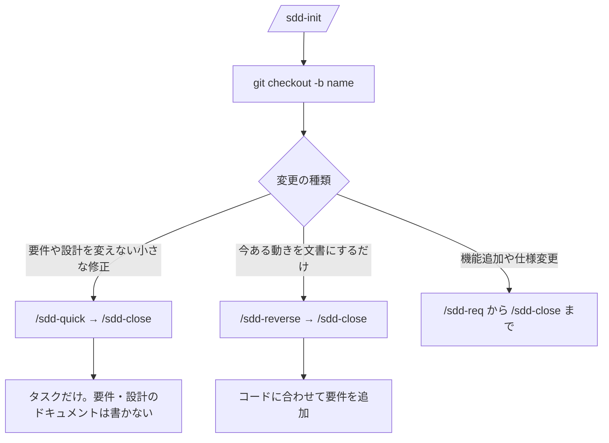
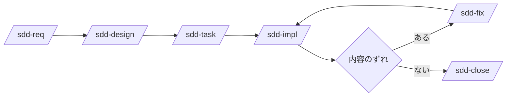

# sdd-orc

[English](README.md)

sdd-orc は Cursor・Codex・Claude Code から [仕様駆動開発（SDD）](https://github.com/paterapatera/sdd-orc) を進めるためのエージェント用スキルと、共通の検査スクリプトをリポジトリに入れるパッケージです。チャットで `/sdd-init` や `/sdd-req` などのスキルを呼び出すと、エージェントが Markdown を書き、検査は各スキルがスクリプト経由で実行します。パッケージ名は `@paterapatera/sdd-orc` 0.3.20 です。Node.js 18 以降が必要です。

issue の登録、プルリクエストの作成、`Closes #1` の記述は別のトラッカー連携スキルの範囲です。このパッケージはトラッカーと通信しません。

## 日常で触るフォルダ

ドキュメントのルートは既定で `docs` です（`init --docs-dir` で変更できます）。

| パス | 意味 |
|---|---|
| `docs/knowledge/` | マージ後も残る仕様・決定記録（ADR）・steering |
| `docs/issues/<name>/` | ブランチ `<name>` で作業中の変更用ファイル。close 後に削除 |

```text
docs/
  knowledge/          ← 恒久の specs、decision/、steering/
  issues/<name>/      ← 変更概要、要件、設計、タスク（ブランチ上のみ）
```

スキル本文は英語です。Git のブランチ名は issue フォルダ名と同じにしてください（例: ブランチもフォルダも `invoice-fix`、または `PROJ-12-invoice-fix` のようにトラッカーキーを付ける）。

## インストール

```sh
npx @paterapatera/sdd-orc init
```

| オプション | 既定値 |
|---|---|
| `--docs-dir` | `docs` |
| `--lang` | `en` |
| `--base-branch` | `main` |
| `--runtime` | `node` |
| `--skills-dir` | `.agents`（エージェントごとに繰り返す） |

例は次のとおりです。

```sh
npx @paterapatera/sdd-orc init --lang ja --runtime bun --skills-dir .agents --skills-dir .claude
```

`sdd.config.json` を書き、各 `<skills-dir>/skills/` に同じスキルをコピーし、検査スクリプトは最初の skills ディレクトリだけに置きます（例: `.agents/skills/sdd-scripts/sdd.mjs`）。CI でネットワークなしに `check` できるよう、`<skills-dir>` をコミットしてください。

`init` は `docs/knowledge/` の骨組みだけを作ります。`steering/` は作りません（`/sdd-steering` で作成）。docs 配下に、このレイアウト外の Markdown があると `init` は止まるので、別の `--docs-dir` を指定してください。インストール後に設定を変える場合は `--force` が必要です。

## 更新

```sh
npx @paterapatera/sdd-orc update
npx @paterapatera/sdd-orc migrate
```

`update` はスキルとスクリプトだけを更新し、`knowledge/` は触りません。`migrate` は将来のフォーマット変更用で、現在のフォーマット版 1 では変換はありません。

## スクリプトと status

`check` や `stamp`、`apply`、`renumber`、`index` などは、通常の作業では各スキルが自動で実行します。人が手で叩く必要はありません。

今のフェーズと、次に使うスキルを確認したいときだけ、次を実行します。

```sh
node .agents/skills/sdd-scripts/sdd.mjs status
```

特定の issue や、開いている issue すべてを見る場合は `--issue <name>` や `--all` を付けます。

実装の段階でテストを自動実行したい場合だけ、`sdd.config.json` の任意項目 `testCommand` にコマンドを書きます。

## 同梱スキル

`/sdd-init`、`/sdd-req`、`/sdd-design`、`/sdd-task`、`/sdd-impl`、`/sdd-fix`、`/sdd-close`、`/sdd-quick`、`/sdd-reverse`、`/sdd-steering` です。

## どの流れを選ぶか

`/sdd-init` で変更の概要を書くと、内容から流れを決め、次に使うスキル（例: `/sdd-quick` や `/sdd-req`）を案内します。ブランチを切り、そのスキルから進めます。



### 通常の機能追加

新しい振る舞いや仕様の変更: `/sdd-req` → `/sdd-design` → `/sdd-task` → `/sdd-impl` → `/sdd-close`。ドキュメントやコードがずれたら `/sdd-fix` してから続けます。

### 小さな変更（quick）

仕様・steering・決定記録を変えずに済む小さな修正: `/sdd-quick` でタスクだけを書き、`/sdd-close`。仕様や steering の更新が必要ならそこで止まります。

### 既存の振る舞いの記録（reverse）

アプリがすでにしている動きを残すだけ: `/sdd-reverse` → `/sdd-close`（設計やタスクのドキュメントが無くても close できる場合があります）。

### 既存アプリに SDD を入れる

`init` → `/sdd-steering` → 変更ごとに `/sdd-init` → init が案内した `/sdd-req` または `/sdd-reverse`。

### 変更を複数、あらかじめ起票する

ベース上で `/sdd-init` を変更の数だけ繰り返し、トラッカーを使う場合はフォルダ名にキーを付け、ブランチごとに close します。



手順の要点は次のとおりです。

1. ベースブランチで `/sdd-init`（変更の概要を作成。ブランチはまだ作らない）。
2. `git checkout -b <name>`
3. init が案内したスキルを順に実行し、各スキルの指示どおりコミットする。
4. `/sdd-close` でベースを取り込み、恒久ドキュメントを更新し、issue フォルダを削除し、PR 用のタイトルと本文を表示する（PR は開かない）。

## 人が決めるところ

| スキル | 作業内容 |
|---|---|
| `/sdd-init` | 目的・変更内容・対象外について最大 3 問 |
| `/sdd-req`、`/sdd-design`、`/sdd-reverse`、`/sdd-fix` | 1 ラウンド最大 5 問（スコア付き選択肢） |
| `/sdd-steering` の Resync | 差分を 1 件ずつ承認・却下・保留 |
| `/sdd-impl` | タスク一覧の手動確認項目を実施（自動ではチェックしない） |
| `/sdd-close` | マージ競合の解消、仕様コードの変更確認（求められた場合）、PR 文面のコピー |

Quick は質問しません。`/sdd-task` も質問しません。

## 任意のウォークスルー

`npm test` では実行しません。

- `node scripts/laravel-fixture-walkthrough.mjs`
- [laravel-fp](https://github.com/paterapatera/laravel-fp) を clone したうえで `node scripts/laravel-fp-walkthrough.mjs`（`LARAVEL_FP` でパス指定）

## プルリクエスト CI（推奨）

```yaml
name: sdd
on:
  pull_request:
jobs:
  check:
    runs-on: ubuntu-latest
    steps:
      - uses: actions/checkout@v4
      - uses: actions/setup-node@v4
        with:
          node-version: 24
      - run: node .agents/skills/sdd-scripts/sdd.mjs check
```

このチェックを必須にすることや、マージ前にベースへ追従させることはリポジトリ設定の推奨であり、このパッケージが強制するものではありません。
