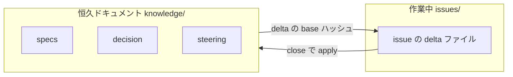
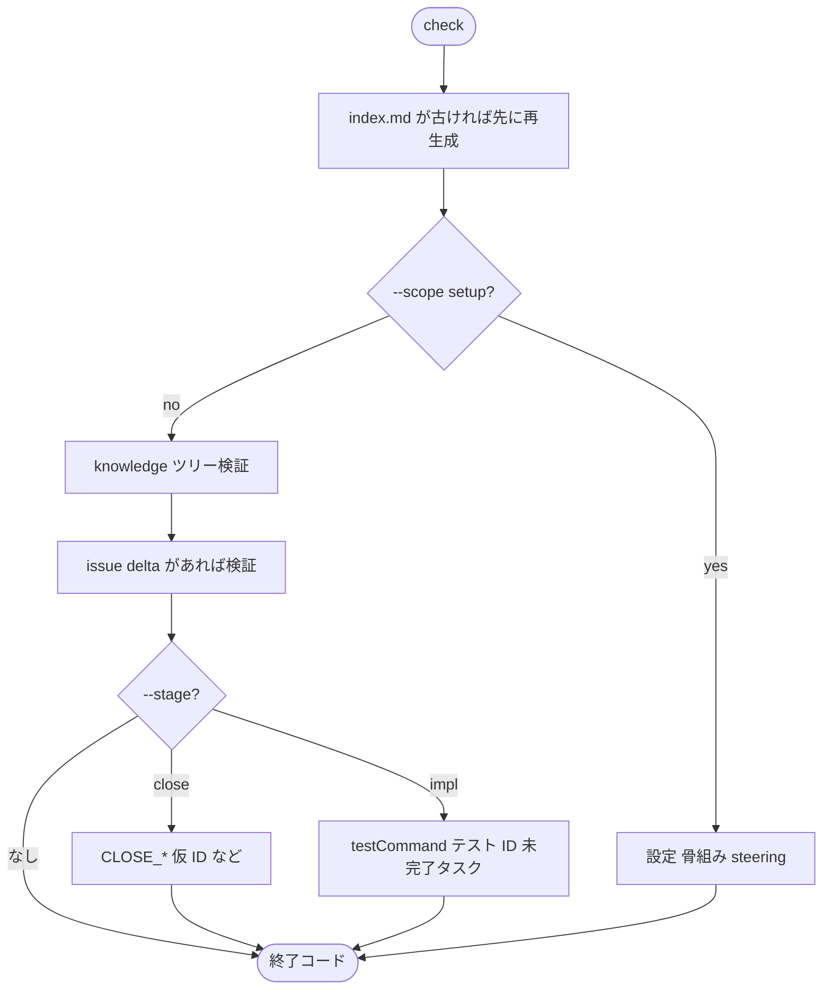
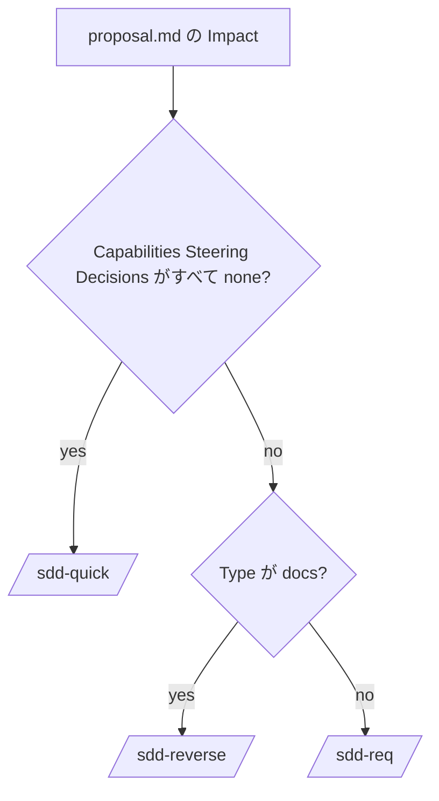
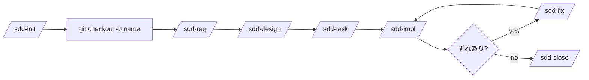
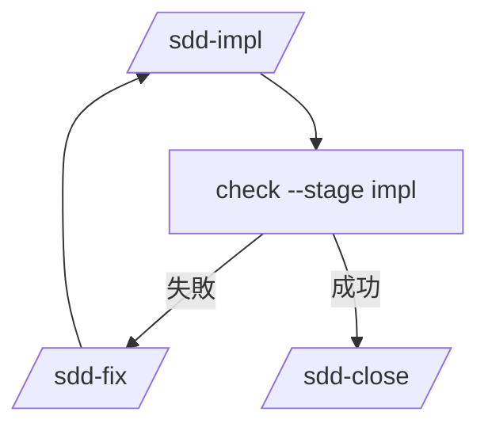
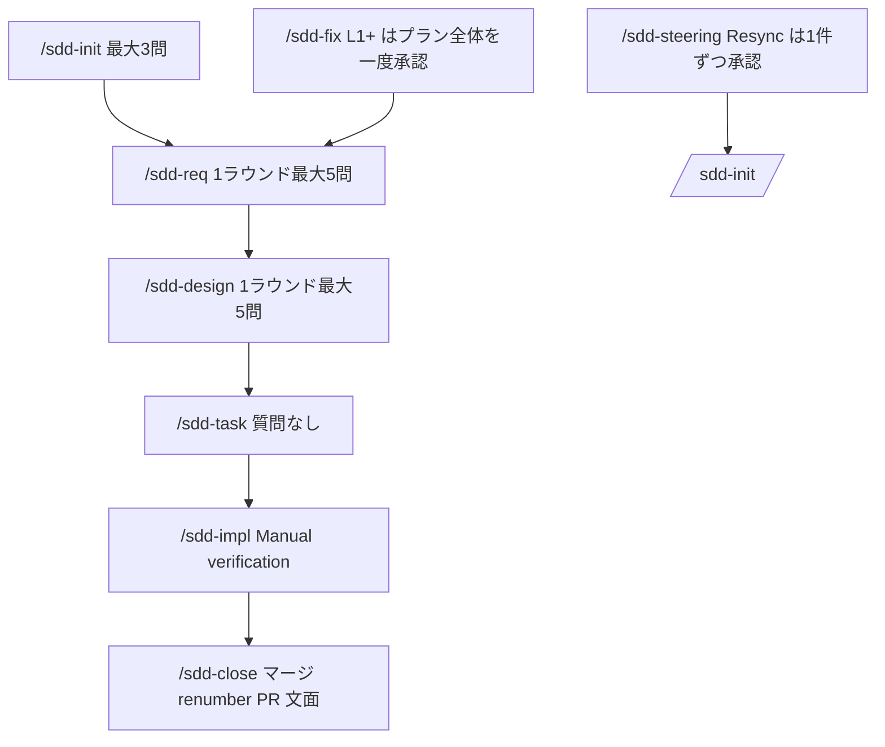
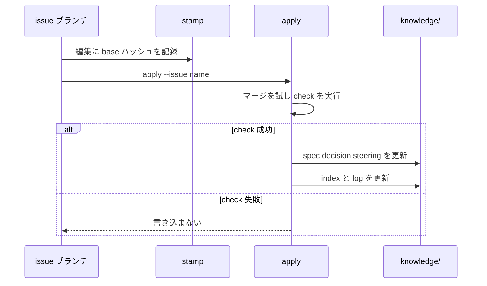

# sdd-orc

[English](README.md)

Cursor、Codex、Claude Code 向けの [仕様駆動開発（SDD）](https://github.com/paterapatera/sdd-orc) スキルと、各スキルが共通で呼び出す検査スクリプトをインストールします。

パッケージ名は `@paterapatera/sdd-orc` 0.3.20 です。恒久ドキュメントは `<docs-dir>/knowledge/` 以下でフォーマット版 1 を使います（`<docs-dir>` の既定値は `docs`）。Node.js 18 以降が必要です。

issue の登録、プルリクエストの作成、`Closes #1` の記述は別のトラッカー連携スキルの範囲です。このパッケージはトラッカーと通信しません。

## インストール後の構成

`init` のあと、リポジトリには次のものが置かれます。

| 場所 | 役割 |
|---|---|
| `sdd.config.json` | ドキュメントパス、言語、ランタイム、ベースブランチ、skills ディレクトリ |
| `<skills-dir>/skills/sdd-*` | エージェント用スキル（スキル本文は **英語**） |
| `<skills-dir>/skills/sdd-scripts/sdd.mjs` | 共通検査スクリプト（**最初の** `--skills-dir` にだけ配置） |
| `<docs-dir>/knowledge/` | **恒久**の spec・決定・steering（フォーマット版 1） |
| `<docs-dir>/issues/<name>/` | ブランチ `<name>` 上の **作業中** 変更用ファイル |

レイアウトは次のとおりです（`<docs-dir>` の既定値は `docs`）。

```text
docs/
  knowledge/
    index.md
    specs/...
    decision/...
    steering/...        ← init では作らない。/sdd-steering で作る
  issues/
    my-feature/         ← ブランチ my-feature 上だけ。close 後に削除
      proposal.md
      requirements.md   ← 通常フロー
      design.md
      task.md
```



恒久ファイルはベースブランチに残ります。issue フォルダには **delta**（ADDED / MODIFIED / REMOVED など）を置き、`/sdd-close` が `apply` で `knowledge/` に反映したあと issue ディレクトリを削除します。

## インストール

リポジトリのルートで次を実行します。

```sh
npx @paterapatera/sdd-orc init
```

`init` は対話しません。既定値は次のとおりです。

| オプション | 既定値 |
|---|---|
| `--docs-dir` | `docs` |
| `--lang` | `en`（`en` または `ja`） |
| `--runtime` | `node`（`node` または `bun`） |
| `--base-branch` | `main` |
| `--skills-dir` | `.agents`（エージェントごとにフラグを繰り返す） |

2 つのエージェント向けの例は次のとおりです。

```sh
npx @paterapatera/sdd-orc init --lang ja --runtime bun --skills-dir .agents --skills-dir .claude
```

`sdd.config.json` を書き、同じスキルをすべての `<skills-dir>/skills/` にコピーし、スクリプトは最初の skills ディレクトリだけに置きます。

```text
.agents/skills/sdd-scripts/sdd.mjs
```

CI がネットワークなしでスクリプトを実行できるよう、`<skills-dir>` をコミットしてください。

`init` は `<docs-dir>/knowledge/` の骨組み（`index.md`、`specs/index.md`、`specs/log.md`、`decision/index.md`）を作ります。`steering/` は作りません。`/sdd-steering` で作成します。ドキュメントディレクトリに、このレイアウトで管理しない Markdown が既にある場合は `init` が停止し、専用の `--docs-dir` を指定するよう案内します。

インストール後に異なる設定を渡すとエラーで終了します。`--force` で上書きできます。

## 更新と移行

```sh
npx @paterapatera/sdd-orc update
npx @paterapatera/sdd-orc migrate
```

`update` は `sdd.config.json` に従ってスキルと共通スクリプトを更新し、`version` を上げます。恒久ドキュメントは変更しません。パッケージの `formatVersion` が設定より新しい場合は `migrate` の実行を促し、ファイルは書き込みません。パッケージから消えた skill は各 skills ディレクトリから削除し、stderr に `UPDATE_REMOVED_SKILL` を出します。

`migrate` は将来フォーマットが変わったときに恒久ドキュメントを機械的に変換します。`check` が失敗した場合は何も書き込みません。フォーマット版 1 では変換対象はなく、`migrate` は “Nothing to convert” と表示します。

## 同梱スクリプト

選んだランタイムで、インストール済みのスクリプトを実行します。コマンド例は次のとおりです。

```sh
node .agents/skills/sdd-scripts/sdd.mjs check
node .agents/skills/sdd-scripts/sdd.mjs stamp --issue <name>
node .agents/skills/sdd-scripts/sdd.mjs apply --issue <name>
node .agents/skills/sdd-scripts/sdd.mjs renumber [--base main] [--code OLD=NEW]
node .agents/skills/sdd-scripts/sdd.mjs index
node .agents/skills/sdd-scripts/sdd.mjs status [--issue <name>] [--all]
```

| コマンド | 用途 |
|---|---|
| `check` | 恒久ツリーと、現在ブランチ（または `--issue`）の issue を検査 |
| `stamp` | delta に `base:` ハッシュが無い編集へ、恒久本文からハッシュを記録 |
| `apply` | issue delta を `knowledge/` に反映。結果が `check` に通らなければ書き込まない |
| `index` | すべての `index.md` を description から再生成 |
| `renumber` | ベースブランチと衝突した、このブランチで追加した ID だけ番号を振り直す |
| `status` | ブランチ、1 issue、または `--all` のフェーズと次スキルを表示 |

終了コードは `0`（問題なし）、`1`（ルール違反）、`2`（使い方またはセットアップ）です。行の形式は `path:line: RULE message` です。

### check のオプション

| オプション | 使う場面 |
|---|---|
| `--scope setup` | 設定・骨組み・steering 必須 5 ファイルだけ |
| `--stage close` | close 時の追加ルール |
| `--stage impl` | `testCommand`、テスト内 ID 参照、未完了の実装タスク |
| `--allow-missing` | issue ディレクトリが無くても成功（Re-close、hotfix） |
| `--format json` | `{ "ok", "diagnostics", "notes" }` を出力 |

`sdd.config.json` の任意項目 `testCommand` は `check --stage impl` のときだけ実行されます（未設定ならスキップ）。

steering や spec の description が変わって `index.md` が古い場合、`check` は他のルールより先に index を再生成します（`healStaleIndexes`）。ツリー全体を検査せず index だけ更新したいとき（`/sdd-close` の Re-close など）は `index` を実行します。`apply` 成功時も index は再生成されます。

Quick issue では、`requirements.md` も `design.md` も無く `task.md` だけがあるものを quick として扱います。issue 中は `validateTasks` は走らず（`TASK_*` なし）、close 前に `check --stage close` で major タスクをすべてチェックしてください（`CLOSE_TASKS`）。



## スキルとブランチ名

各スキルは原則として最初に `check --scope setup` を実行します。**Git のブランチ名は issue フォルダ名と同じ**にします。作業ファイルは `<docs-dir>/issues/<name>/`、ブランチは `<name>` です（トラッカーキー付き `PROJ-123-my-feature` も可）。

同梱スキルは `/sdd-init`、`/sdd-req`、`/sdd-design`、`/sdd-task`、`/sdd-impl`、`/sdd-fix`、`/sdd-close`、`/sdd-quick`、`/sdd-reverse`、`/sdd-steering` です。`/sdd-brownfield` はありません。

### 次に使うスキルの決め方

`proposal.md` 作成後、`/sdd-init` が Impact から次スキルを指示します。



作業中は `status` でフェーズと次スキル（例: `design -> /sdd-task`）を確認できます。

### 通常の変更（機能追加など）



1. `/sdd-init` で `issues/<name>/proposal.md` を作成する（ブランチは作らない）。
2. `git checkout -b <name>`
3. `/sdd-req` → `requirements.md`
4. `/sdd-design` → `research.md`、`design.md`
5. `/sdd-task` → `task.md`（`design.md` があるとき、engine が `Depends on:`、トレーサビリティ、minor の `Requirements:` を検査）。
6. `/sdd-impl` で未完了の major を実装する。ずれがあれば `/sdd-fix`。
7. `/sdd-close` でベースを取り込み、`apply` と `check --stage close` を実行し、issue ディレクトリを削除し、PR タイトルと本文を出力する（PR は開かない）。

### 小さな変更（quick）

`/sdd-init` → `/sdd-quick` → `/sdd-close`。Quick は質問せず、requirements、research、design は書きません。specs、steering、決定の変更が必要な場合は停止します。

### 既存の振る舞いの書き起こし（reverse）

`Type: docs` の `/sdd-init` → `/sdd-reverse` → `/sdd-close`。Reverse は requirements の追加だけを行います。design や task が無くても close できる docs-only ルールがあります。

### 稼働中のアプリへ SDD を導入する

1. `npx @paterapatera/sdd-orc init`
2. `/sdd-steering`（既存 spec がある場合は要件 ID とコード参照の突合を含む Resync）
3. 変更ごとに `/sdd-init` → proposal に応じて `/sdd-reverse` または `/sdd-req`

### 複数の proposal をベースブランチに置く

1. ベースブランチ上で、変更ごとに `/sdd-init` を実行する。
2. トラッカーに issue を登録する（別スキルでも可）。各ディレクトリ名の先頭にトラッカーのキーを付ける。
3. ベースブランチに `proposal.md` をコミットする。
4. `git checkout -b <key>-<name>` で着手し、`/sdd-req` または `/sdd-quick` から進める。
5. `/sdd-close` でブランチ上の issue ディレクトリを削除する。マージ後はベースからも消える。

### 実装中の修正（fix）

実装やレビューでドキュメントとコードがずれたときは `/sdd-fix` を使います。L1 以上は修正プラン全体を一度承認し、上流から順に delta を直します。Quick issue では L0 だけその場で直し、L1 以上は `/sdd-req`、`/sdd-design`、`/sdd-task` へ進む。



## 人が決めるポイント

エージェントが質問し、選択肢から答えます。スクリプトはこれらの判断を代行しません。



| 段階 | 人の役割 |
|---|---|
| `/sdd-init` | Why / What Changes / Out of Scope について最大 3 問 |
| `/sdd-req`、`/sdd-design`、`/sdd-reverse`、`/sdd-fix` | 1 ラウンド最大 5 問（スコア付き選択肢） |
| `/sdd-steering` Resync | 差分を 1 件ずつ accept / reject / defer |
| `/sdd-impl` | Manual verification の major を人が実施（自動チェック対象外） |
| `/sdd-close` | マージ競合の解消、`--code OLD=NEW` の確認、PR タイトル・本文のコピー |

## delta、stamp、apply

issue ファイルは delta 節（ADDED、MODIFIED、REMOVED など）を使い、恒久本文に対応する `base:` ハッシュを書きます。



`/sdd-close` は `apply` のあと `check --stage close` を実行します。`BASE_MISMATCH` は `/sdd-fix` L2 で古い `base:` を削除し、`stamp` して再試行します。

## 手動検証スクリプト

`scripts/` には、自動テスト（`node --test`）の対象外の任意スクリプトがあります。

- `node scripts/laravel-fixture-walkthrough.mjs`（Laravel 風の一時リポジトリで init から close まで）
- [laravel-fp](https://github.com/paterapatera/laravel-fp) を clone したうえで `node scripts/laravel-fp-walkthrough.mjs`（`LARAVEL_FP` でパス指定可）。

## プルリクエスト

プルリクエストの CI で `check` を実行し、そのチェックを必須にすることを推奨します。マージ前にベースブランチへ追従させるブランチ保護も推奨します。これらはリポジトリ設定の推奨であり、このパッケージが必須とするものではありません。

次のジョブは共通スクリプトだけを実行します。トラッカーや、ワークフロー実行環境以外の CI 製品は呼びません。

```yaml
name: sdd
on:
  pull_request:
jobs:
  check:
    runs-on: ubuntu-latest
    steps:
      - uses: actions/checkout@v4
      - uses: actions/setup-node@v4
        with:
          node-version: 24
      - run: node .agents/skills/sdd-scripts/sdd.mjs check
```

`sdd.config.json` の `"runtime"` が `"bun"` で Bun が入っているときは `node` の代わりに `bun` を使います。同梱の `sdd.mjs` は Node 用スクリプト（`#!/usr/bin/env node`）なので、Bun が無い環境では Node のまま実行できます（例: `node .agents/skills/sdd-scripts/sdd.mjs check`）。Node 18 以降を想定します（下の CI 例は 24）。スキル本文が `bun` と書いていても、手元で Bun が無ければコマンドだけ `node` に読み替えてください。スクリプトが別の skills ディレクトリにある場合は、そのパスに読み替えてください。
