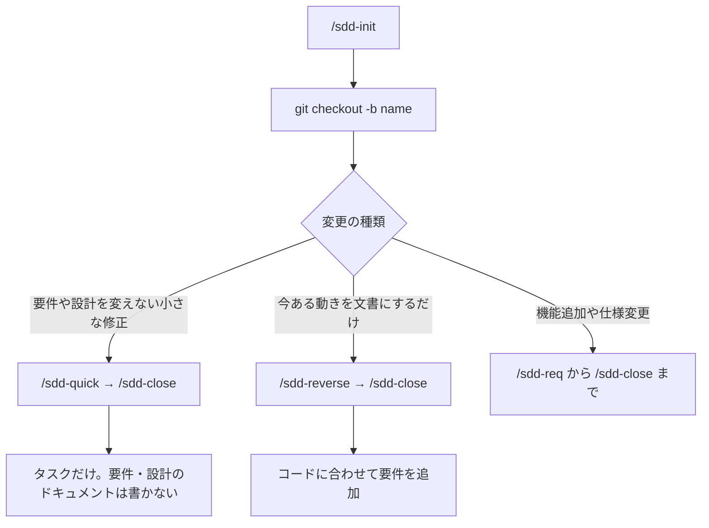
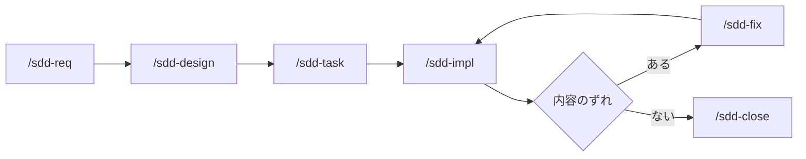
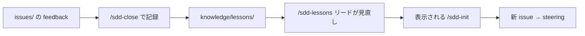

# sdd-orc

[English](README.md)

sdd-orc は Cursor・Codex・Claude Code から [仕様駆動開発（SDD）](https://github.com/paterapatera/sdd-orc) を進めるためのエージェント用スキルと、共通の検査スクリプトをリポジトリに入れるパッケージです。チャットで `/sdd-init` や `/sdd-req` などのスキルを呼び出すと、エージェントが Markdown を書き、検査は各スキルがスクリプト経由で実行します。パッケージ名は `@paterapatera/sdd-orc` 1.2.0 です。Node.js 18 以降が必要です。

issue の登録、プルリクエストの作成、`Closes #1` の記述は別のトラッカー連携スキルの範囲です。このパッケージはトラッカーと通信しません。

## 日常で触るフォルダ

ドキュメントのルートは既定で `docs` です（`npx @paterapatera/sdd-orc init --docs-dir <path>` で変更できます）。

| パス | 意味 |
|---|---|
| `docs/knowledge/` | マージ後も残る仕様・決定記録（ADR）・steering |
| `docs/knowledge/lessons/` | 過去に起きた問題と再発防止の方針（削除せず、状態はここで管理） |
| `docs/issues/<name>/` | ブランチ `<name>` で作業中の変更用ファイル。close 後に削除 |

```text
docs/
  knowledge/          ← 恒久の specs、decision/、steering/、lessons/
  issues/<name>/      ← 変更概要、要件、設計、タスク、feedback（ブランチ上のみ）
```

スキル本文は英語です。Git のブランチ名は issue フォルダ名と同じにしてください（例: ブランチもフォルダも `invoice-fix`、または `PROJ-12-invoice-fix` のようにトラッカーキーを付ける）。

## インストール

```sh
npx @paterapatera/sdd-orc init
```

**インストール後:** まず **エージェントチャット**で `/sdd-steering` を実行します。`docs/knowledge/steering/` の steering ドキュメントを作成します（`init` コマンドでは作りません）。すでにアプリのコードがあるリポジトリでは、コードを読んで steering を合わせます。新規プロジェクトでは初期の steering を作成します。そのあと、変更ごとにベースブランチで `/sdd-init` から始めます。

| オプション | 既定値 |
|---|---|
| `--docs-dir` | `docs` |
| `--lang` | `en` |
| `--base-branch` | `main` |
| `--runtime` | `node` |
| `--skills-dir` | `.agents`（エージェントごとに繰り返す） |

例は次のとおりです。

```sh
npx @paterapatera/sdd-orc init --lang ja --runtime bun --skills-dir .agents --skills-dir .claude
```

`sdd.config.json` を書き、各 `<skills-dir>/skills/` に同じスキルをコピーし、検査スクリプトは最初の skills ディレクトリだけに置きます（例: `.agents/skills/sdd-scripts/sdd.mjs`）。CI でネットワークなしに `check` できるよう、`<skills-dir>` をコミットしてください。

`npx @paterapatera/sdd-orc init` は `docs/knowledge/` の骨組みだけを作ります。`steering/` は作りません（上の **インストール後** を参照）。docs 配下に、このレイアウト外の Markdown があるとコマンドは止まるので、別の `--docs-dir` を指定してください。インストール後に設定を変える場合は `--force` が必要です。

## 更新

```sh
npx @paterapatera/sdd-orc update
npx @paterapatera/sdd-orc migrate
```

`update` はスキルとスクリプトだけを更新し、`knowledge/` は触りません。**1.2.0 へ上げるとき:** 進行中 issue の delta で **ADDED** / **MODIFIED** の各 `REQ-*` に `- Process:` 行を足してから `check` を通してください。`migrate` は将来のフォーマット変更用で、現在のフォーマット版 1 では変換はありません。

## スクリプトと status

`check` や `stamp`、`apply`、`renumber`、`index`、`status`、`fp` などは、通常の作業では各スキルが自動で実行します。人が手で叩く必要はありません。

今のフェーズと、次に使うスキルを確認したいときだけ、次を実行します。

```sh
node .agents/skills/sdd-scripts/sdd.mjs status
```

特定の issue や、開いている issue すべてを見る場合は `--issue <name>` や `--all` を付けます。

実装の段階でテストを自動実行したい場合だけ、`sdd.config.json` の任意項目 `testCommand` にコマンドを書きます。

## 機能ポイント（`fp`）

チェッカーは、issue ごとに**カスタム機能ポイント（FP）**を機械的に数えます。同じ delta なら常に同じ結果になり、後から工数と比べる材料にできます。**sdd-orc は時間を計測しません**（時間の取り方は開発手法側の判断です）。

機能ブランチ上（ブランチ名 = issue フォルダ名）で実行するか、`--issue` で名前を指定します。

```sh
node .agents/skills/sdd-scripts/sdd.mjs fp
node .agents/skills/sdd-scripts/sdd.mjs fp --issue invoice-fix --format json
```

| 対象 | ポイント |
|---|---|
| `data.md` の `DATA-*`（社内データ・低複雑度） | 各 7 |
| `Direction: Consumed` の `IF-*`（外部参照・低） | 各 5 |
| `Direction: Provided` の `IF-*` | 各 4 |
| 要素プロセス（issue delta の `REQ-*` に付ける `Process:`） | 同名プロセスごとに **EI** 4、**EO** 5、**EQ** 4（**IFPUG/NESMA 認定ではないカスタム指標**） |
| `Process: none` の REQ | 0（件数は出力に表示） |
| `NFR-*`、steering、ADR、構造だけの delta | 0 |

issue delta の **ADDED / MODIFIED** の各 `REQ-*` には `- Process: <名前> (EI|EO|EQ)` または `- Process: none` が必要です（`check` が検査します）。複数の REQ が同じ名前を共有できます。**`fp` はそのプロセスを 1 回だけ数えます。** 例: 3 つの REQ がすべて `- Process: Confirm order (EQ)` なら **EQ 1 件 = 4 FP** であり、12 FP にはなりません。

issue の delta（`requirements.md` と、あれば `design.md` / `research.md` をマージ）の **ADDED / MODIFIED / REMOVED** から数えます。`/steering/` 配下は除外します。REQ **id** は capability ファイルごとに 1 回まで（**REMOVED > MODIFIED > ADDED**）。**プロセス**は `Process:` 名（前後空白は trim、連続空白は 1 つに）と型でグループ化します。**プロセスの bucket**（EI/EO/EQ 表の ADDED/MODIFIED/REMOVED）：グループ内の REQ がすべて **REMOVED** なら **REMOVED**；それ以外で **その処理のグループ内**に **MODIFIED** または **REMOVED** の REQ が 1 件でもあれば **MODIFIED**；さらに **ベースブランチ**の spec に同名プロセスがあれば **MODIFIED**（`git show` のみ。作業ツリーは見ません）；それ以外は **ADDED**。**MODIFIED** / **REMOVED** も **ADDED** と同じ満点の EI/EO/EQ 重みです。**quick issue** は対象外です。結果は **stdout のみ**です。**REMOVED** の `REQ-*` で delta に `Process` がないときは **ベースブランチ**の `spec.md` から読み、見つからなければ **不明プロセス（0 FP）** 行に載せます（REMOVED `IF-*` と同様の参照順）。**REMOVED** の `IF-*` で `Direction` がないときはベースブランチの `interfaces.md` を読みます。**MODIFIED** の `IF-*` は delta に `Direction` が必要で、なければ **IF unset**（0 FP）です。

**既知の限界（REMOVED `IF-*` とプロセス参照）:** 参照に失敗したときは **`IF unset (0 FP)`** や **不明プロセス（0 FP）** の行で示します（黙って 0 にはしません）。(1) **ローカルにベースブランチがない** — 例: `git clone -b <機能ブランチ>` や、`origin/main` だけの浅い clone でローカル `main` がない。REMOVED IF は 0 FP です。`Process:` 行のない **REMOVED** の `REQ-*`（旧 spec でよくあります）は apply 後に解決できず **不明プロセス（0 FP）** 行に載ります。レポートに名前が必要なら REMOVED ブロックに `- Process:` を書いてください。ローカルにベースブランチがないとき、この issue で **ADDED** の REQ だけのプロセスは表では **MODIFIED** ではなく **ADDED** と表示されます。FP 合計は変わりません。(2) **同じブランチで前の issue が追加した IF を、後の issue が削除** — apply 後はベースブランチにその IF がないため 0 FP です。(3) **モノレポのサブディレクトリ** — git パスはリポジトリルート基準です（`renumber` と同じ）。apply 後に REMOVED IF が 0 になることがあります。(4) **apply の前** — 作業ツリーの knowledge を先に読むため、未コミットの編集で FP が変わることがあります（その状態では check が通らないため、close で出す PR 用の値は通常安定します）。

**`/sdd-close`** は issue フォルダを消す**前**に `fp --format json` を実行し、表示する PR 本文に短い **機能ポイント**節を足します（合計、**DATA** / **EI** / **EO** / **EQ** / **IF** の FP と ADDED/MODIFIED/REMOVED、REQ 件数とプロセス件数、必要なら **Process: none**・**不明プロセス**・**IF unset**・**NFR** の 0 FP 行。quick issue は「数えない」1 行のみ）。

## 同梱スキル

`/sdd-init`、`/sdd-req`、`/sdd-design`、`/sdd-task`、`/sdd-impl`、`/sdd-fix`、`/sdd-close`、`/sdd-lessons`、`/sdd-quick`、`/sdd-reverse`、`/sdd-steering` です。

## どの流れを選ぶか

`/sdd-init` で変更の概要を書くと、内容から流れを決め、次に使うスキル（例: `/sdd-quick` や `/sdd-req`）を案内します。ブランチを切り、そのスキルから進めます。



### 通常の機能追加

新しい振る舞いや仕様の変更です。init が `/sdd-req` を案内したあとの流れは次のとおりです。



手順。**エージェントチャット**と書いてある操作はチャット、それ以外はターミナルです。

1. **エージェントチャット:** ベースブランチで `/sdd-init`（変更の概要を作成。ブランチはまだ作らない）。
2. **ターミナル:** `git checkout -b <name>`（init が決めた issue フォルダ名と同じ）。
3. **エージェントチャット:** `/sdd-req` → `/sdd-design` → `/sdd-task` → `/sdd-impl`。各スキルの指示どおりコミットする。ずれたら `/sdd-fix` してから続ける。
4. **エージェントチャット:** `/sdd-close` でベースを取り込み、恒久ドキュメントを更新し、issue フォルダを削除し、PR 用のタイトルと本文を表示する（PR は開かない）。

### 小さな変更（quick）

仕様・steering・決定記録を変えずに済む小さな修正です。上と同じ 1・2 のあと、**エージェントチャット**で `/sdd-quick`（タスクだけ）→ `/sdd-close`。仕様や steering の更新が必要ならそこで止まります。

### 既存の振る舞いの記録（reverse）

**コードにはすでに動きがあるのに、仕様に書かれていない**ときに使います。典型例は既存アプリに SDD を入れた直後（コードから仕様を埋める）、または残したい動きが文書化されていないと気づいたときです。一度に全部を書く必要はありません。重要な機能や、これから手を入れる機能から始めてください。

**`/sdd-steering` との違い:** steering は**プロジェクト全体**の前提（目的、技術、構成など）をまとめます。インストール後に一度行う。reverse は**一つの機能**について、すでにあるコードの動きを `specs/` の要件として残す。機能ごとに `/sdd-init` から繰り返す。

最初から `/sdd-reverse` だけを呼ばないでください。**ベースブランチ**で **エージェントチャット**に、次のような文をそのまま送れます。

```text
/sdd-init 請求書の締め処理の今の動きを仕様に記録したい。コードは変えない。
```

要点は **すでにある動きを文書に残す**ことで、新機能の追加やバグ修正ではないと伝えることです。init が最大 3 問聞く場合も、同じ目的で答えてください。

init が終わると変更の概要を書き、**コードを変えない文書化**として分類し、次のスキルは **`/sdd-reverse`** と案内します。そのあと **ターミナル** `git checkout -b <name>`、**エージェントチャット** `/sdd-reverse` → `/sdd-close`。設計やタスクのドキュメントは省略されることが多く、close でも検査は走ります。

## GitHub の issue と連携して使う場合

GitHub Issues で進捗を管理するときの例です（issue や PR の作成はこのパッケージの範囲外。別のトラッカー連携スキルか手作業）。

1. **エージェントチャット:** ベースブランチで、予定している変更の数だけ `/sdd-init` を実行する。
2. 各変更を GitHub issue として登録する（トラッカースキルまたは手動）。
3. フォルダ名・ブランチ名の先頭に issue 番号やキーを付ける（例: `42-invoice-fix`）。
4. **ターミナル:** ベースブランチへ変更概要をコミットする。
5. **ターミナル:** issue ごとに `git checkout -b <name>`。**エージェントチャット:** スキルを `/sdd-close` まで実行する。PR を開くときは `Closes #42` などで issue と結び付ける（手動またはトラッカースキル）。

## 教訓（lessons）・close・見直し

作業中、スキルがブランチ上の `docs/issues/<name>/feedback.md` に短いメモを追記することがあります（日常の仕様作業で人が編集するものではありません）。追記したらブランチにコミットしておき、close の前にメモが消えないようにします。**`/sdd-close`** では、エージェントがそのメモを読み、`docs/knowledge/lessons/` に**記録**します。新規は状態 **`candidate`**。再発は **Occurrence log** に日付付きの行を足します（issue 名は書きません）。再発がなく見直した close には **Review closes** の日付を足します。issue フォルダを消す前に、「この教訓を記録してよいか」といった**短い確認**だけをします。`- Lessons:` 行は検査用に残します。close では steering を直さず、教訓の状態も採用判断もしません。**`/sdd-init` の文も出しません**。

**リード**が定期的に **`/sdd-lessons`** を実行して、採用（試行 `trial`）、却下、保留、昇格（`effective` / `ineffective`）を決めます。例: **`/sdd-lessons 今月の教訓を見直したい`**。一覧は **A〜D** のいずれか**一つ**にだけ載せます（未判断の候補、保留・却下後の再発、有効に上げられる trial ※ログより**後の日付**の **Review closes** が条件を満たし、かつ **Last reviewed** より**後の日付**の close が少なくとも 1 件（同日は数えない）、再発した trial/effective ※**C** と **D** が両方当てはまるときは **D** のみ — 詳細はスキル本文）。steering 変更は **`/sdd-init ...`** の案のみ（close ではありません）。教訓は削除しません。要件や実装のスキルが読むのは **steering だけ**で、教訓ページは読みません。通常の `check` で教訓ページが変わったとき、索引だけ自動で直ることがあり、そのとき短いメモが出ます。

ベースを取り込んで **re-close** するとき、同じ教訓ページが競合したら、状態は rejected → ineffective → effective → trial → candidate の順で厳しい方を残し、rejected または ineffective が勝った場合はその Reason を残します。



## 人が決めるところ

| スキル | 作業内容 |
|---|---|
| `/sdd-init` | 目的・変更内容・対象外について最大 3 問 |
| `/sdd-req`、`/sdd-design`、`/sdd-reverse`、`/sdd-fix` | 1 ラウンド最大 5 問（スコア付き選択肢） |
| `/sdd-steering` の Resync | 差分を 1 件ずつ承認・却下・保留 |
| `/sdd-impl` | タスク一覧の手動確認項目を実施（自動ではチェックしない） |
| `/sdd-close` | マージ競合の解消、仕様コードの変更確認（求められた場合）、**教訓の記録の確認**、PR 文面のコピー |
| `/sdd-lessons` | **リード:** 教訓の採用・却下・保留・昇格、`/sdd-init` 案の表示（steering は直接編集しない） |

Quick は質問しません。`/sdd-task` も質問しません。

## プルリクエスト CI（推奨）

```yaml
name: sdd
on:
  pull_request:
jobs:
  check:
    runs-on: ubuntu-latest
    steps:
      - uses: actions/checkout@v4
      - uses: actions/setup-node@v4
        with:
          node-version: 24
      - run: node .agents/skills/sdd-scripts/sdd.mjs check
```

このチェックを必須にすることや、マージ前にベースへ追従させることはリポジトリ設定の推奨であり、このパッケージが強制するものではありません。
