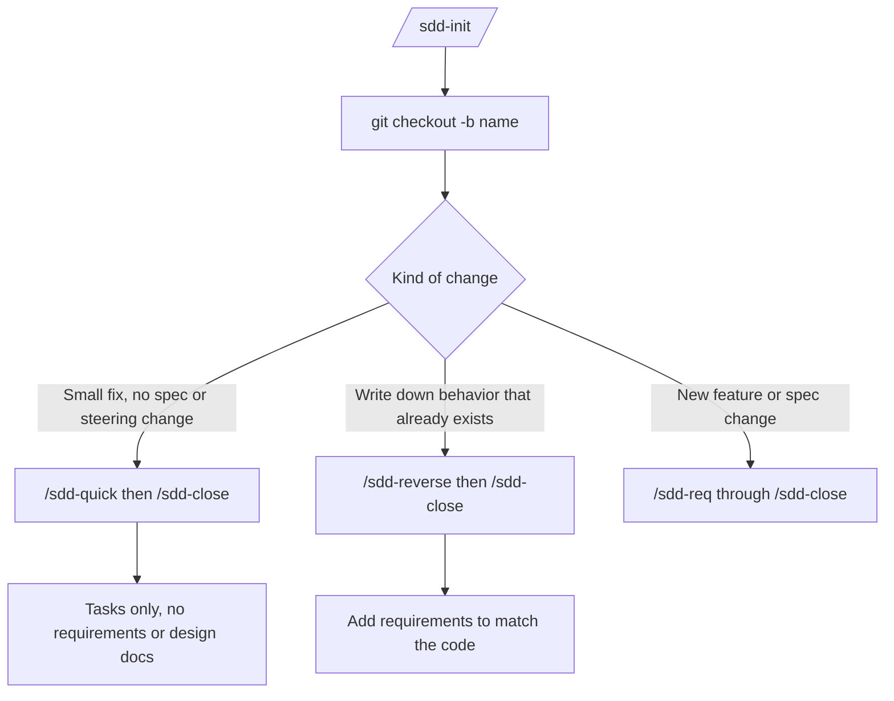
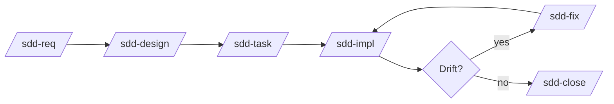

# sdd-orc

[日本語](README.ja.md)

**sdd-orc** installs agent skills and one checker script so you can run [Specification-Driven Development (SDD)](https://github.com/paterapatera/sdd-orc) in Cursor, Codex, or Claude Code. You invoke skills such as `/sdd-init` and `/sdd-req` in chat; the agent writes Markdown and runs the checker through those skills. Package: `@paterapatera/sdd-orc` 0.3.20. Node.js 18 or later.

Registering tracker issues, opening pull requests, and writing `Closes #1` belong to a separate tracker skill. This package does not talk to a tracker.

## Folders you work with

Default docs root is `docs` (change with `init --docs-dir`).

| Path | Meaning |
|---|---|
| `docs/knowledge/` | Specs, ADRs, and steering that stay on the main branch |
| `docs/issues/<name>/` | Draft for one change while you are on Git branch `<name>`; removed when you close |

```text
docs/
  knowledge/          ← permanent specs, decision/, steering/
  issues/<name>/      ← change summary, requirements, design, task (while on branch <name>)
```

Skill text is **English**. Branch name must match the issue folder name (for example branch and folder `invoice-fix`, or `PROJ-12-invoice-fix` with a tracker prefix).

## Install

```sh
npx @paterapatera/sdd-orc init
```

| Flag | Default |
|---|---|
| `--docs-dir` | `docs` |
| `--lang` | `en` |
| `--runtime` | `node` |
| `--base-branch` | `main` |
| `--skills-dir` | `.agents` (repeat per agent) |

Example:

```sh
npx @paterapatera/sdd-orc init --lang ja --runtime bun --skills-dir .agents --skills-dir .claude
```

This writes `sdd.config.json`, copies skills to each `<skills-dir>/skills/`, and installs the checker at the first skills dir only (for example `.agents/skills/sdd-scripts/sdd.mjs`). Commit `<skills-dir>` so CI can run `check` offline.

`init` creates `docs/knowledge/` skeleton files. It does not create `steering/` (use `/sdd-steering`). If unrelated Markdown already lives under the docs dir, `init` stops; pick another `--docs-dir`. After install, different settings require `--force`.

## Update

```sh
npx @paterapatera/sdd-orc update
npx @paterapatera/sdd-orc migrate
```

`update` refreshes skills and the script; it does not edit `knowledge/`. `migrate` is for future format changes; format version 1 has nothing to convert.

## Script and status

Skills run the bundled checker (`check`, `stamp`, `apply`, `renumber`, `index`, and related steps) during each phase. You do not need to run those commands yourself in normal work.

To see the current phase and the next skill for your branch, run:

```sh
node .agents/skills/sdd-scripts/sdd.mjs status
```

Add `--issue <name>` or `--all` when you want a specific issue or every open issue.

If `/sdd-impl` should run your test suite automatically, set optional `testCommand` in `sdd.config.json`.

## Skills included

`/sdd-init`, `/sdd-req`, `/sdd-design`, `/sdd-task`, `/sdd-impl`, `/sdd-fix`, `/sdd-close`, `/sdd-quick`, `/sdd-reverse`, `/sdd-steering`.

## Which path to take

After `/sdd-init` creates the change summary file, it picks the path for you and names the next skill (for example `/sdd-quick` or `/sdd-req`). Create the branch and follow that skill.



### Normal feature

New behavior or a spec change: `/sdd-req` → `/sdd-design` → `/sdd-task` → `/sdd-impl` → `/sdd-close`. If docs or code drift, use `/sdd-fix` then continue.

### Quick (small change)

A small fix that does not change requirements, steering, or decision records: `/sdd-quick` writes a task list only, then `/sdd-close`. The skill stops if a spec or steering update is needed.

### Reverse (document existing behavior)

You only need to record how the app already works: `/sdd-reverse` → `/sdd-close` (sometimes without design or task documents).

### SDD on an existing app

Run `init`, then `/sdd-steering`, then open each change with `/sdd-init` and continue with `/sdd-req` or `/sdd-reverse` as init directs.

### Several changes planned upfront

Run `/sdd-init` once per change on the base branch, use tracker keys in folder names if you use a tracker, branch per change, and close each branch separately.



Steps in words:

1. `/sdd-init` on the base branch (creates the change summary; no branch yet).
2. `git checkout -b <name>`
3. Run the skills init pointed you to; commit docs as each skill says.
4. `/sdd-close` merges the base branch, updates permanent docs, removes the issue folder, and prints PR title and body (does not open the PR).

## Where you decide (not the script)

| Skill | You |
|---|---|
| `/sdd-init` | Up to 3 questions about purpose, what changes, and what is out of scope |
| `/sdd-req`, `/sdd-design`, `/sdd-reverse`, `/sdd-fix` | Up to 5 scored choices per round |
| `/sdd-steering` Resync | Accept, reject, or defer each reported item |
| `/sdd-impl` | Complete manual verification tasks in the task list (not auto-checked) |
| `/sdd-close` | Resolve merge conflicts; confirm renamed spec codes if prompted; copy PR text |

Quick path asks no questions. `/sdd-task` asks no questions.

## Optional walkthrough scripts

Not run by `npm test`:

- `node scripts/laravel-fixture-walkthrough.mjs`
- Clone [laravel-fp](https://github.com/paterapatera/laravel-fp), then `node scripts/laravel-fp-walkthrough.mjs` (`LARAVEL_FP` for path)

## Pull request CI (recommended)

```yaml
name: sdd
on:
  pull_request:
jobs:
  check:
    runs-on: ubuntu-latest
    steps:
      - uses: actions/checkout@v4
      - uses: actions/setup-node@v4
        with:
          node-version: 24
      - run: node .agents/skills/sdd-scripts/sdd.mjs check
```

Making this check required and keeping the branch up to date with the base branch are repository settings; this package does not enforce them.
