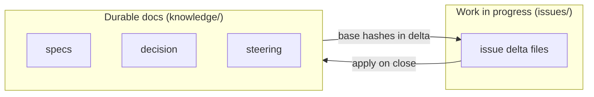
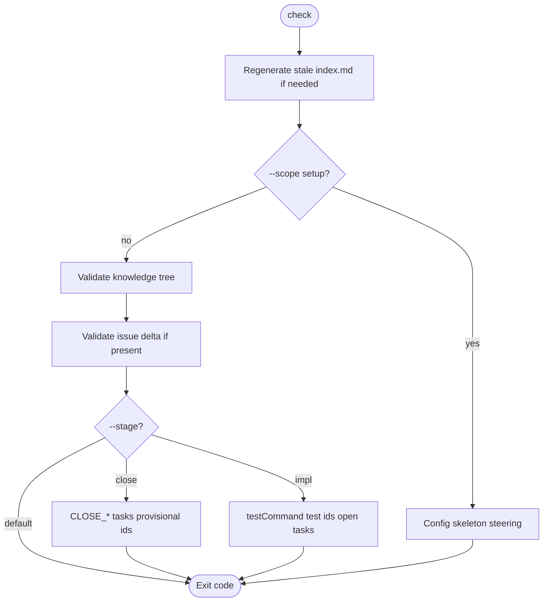
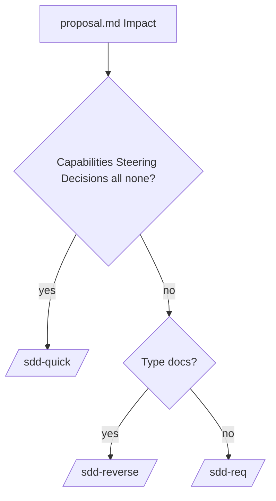
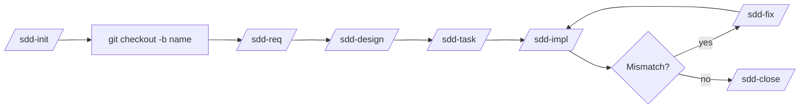
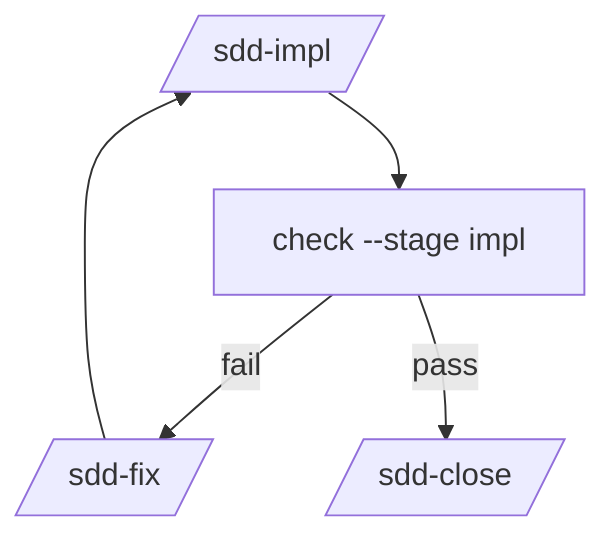
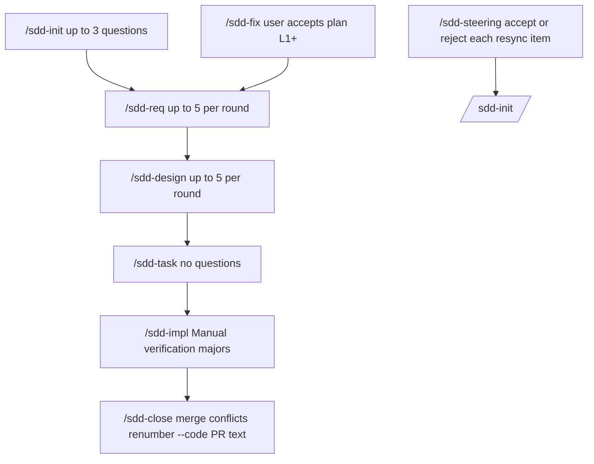
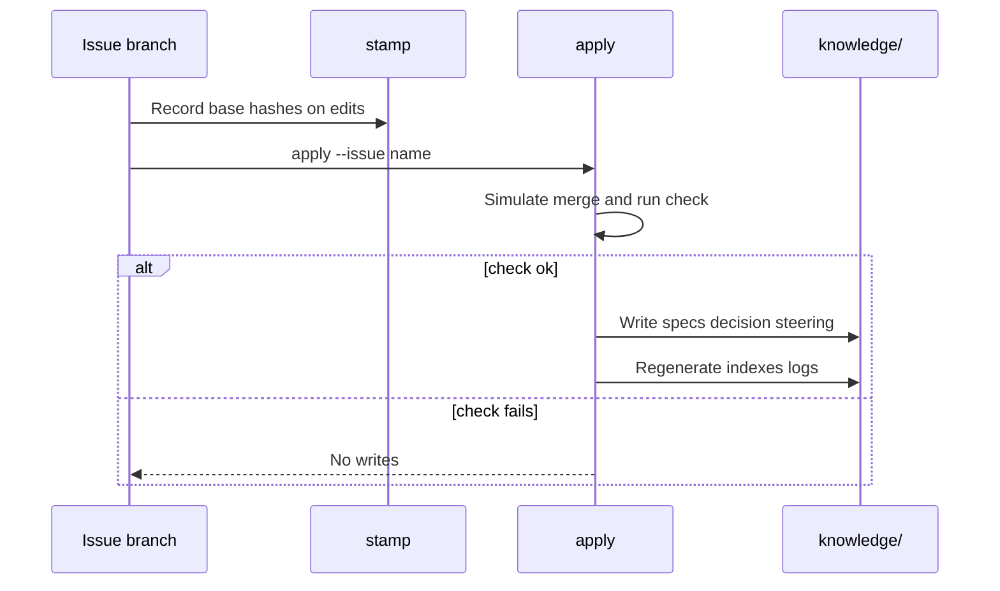

# sdd-orc

[日本語](README.ja.md)

This package installs [Specification-Driven Development (SDD)](https://github.com/paterapatera/sdd-orc) skills for Cursor, Codex, and Claude Code, plus one shared checker script that every skill calls.

Package name: `@paterapatera/sdd-orc` 0.3.20. Node.js 18 or later is required.

Registering tracker issues, opening pull requests, and writing `Closes #1` are handled by a separate tracker skill. **This package does not talk to a tracker.**

## What you get

After `init`, your repository contains:

| Location | Role |
|---|---|
| `sdd.config.json` | Docs path, language, runtime, base branch, skills directories |
| `<skills-dir>/skills/sdd-*` | Agent skills (skill text is **English**) |
| `<skills-dir>/skills/sdd-scripts/sdd.mjs` | Shared checker (installed under the **first** `--skills-dir` only) |
| `<docs-dir>/knowledge/` | **Durable** specs, decisions, and steering (format version 1) |
| `<docs-dir>/issues/<name>/` | **Temporary** work for one change while you are on branch `<name>` |

Default `<docs-dir>` is `docs`. Example layout:

```text
docs/
  knowledge/
    index.md
    specs/...
    decision/...
    steering/...        ← created by /sdd-steering, not by init
  issues/
    my-feature/         ← exists only on branch my-feature until close
      proposal.md
      requirements.md   ← normal path
      design.md
      task.md
```



Durable files stay on the base branch. Issue folders hold **deltas** (ADDED / MODIFIED / REMOVED sections) until `/sdd-close` runs `apply`, which merges them into `knowledge/` and deletes the issue directory.

## Install

From the repository root:

```sh
npx @paterapatera/sdd-orc init
```

`init` does not prompt. Defaults:

| Flag | Default |
|---|---|
| `--docs-dir` | `docs` |
| `--lang` | `en` (`en` or `ja`) |
| `--runtime` | `node` (`node` or `bun`) |
| `--base-branch` | `main` |
| `--skills-dir` | `.agents` (repeat the flag for each agent) |

Example for two agents:

```sh
npx @paterapatera/sdd-orc init --lang ja --runtime bun --skills-dir .agents --skills-dir .claude
```

This writes `sdd.config.json`, copies the same skills into every `<skills-dir>/skills/`, and copies one script to the first skills directory only:

```text
.agents/skills/sdd-scripts/sdd.mjs
```

Commit `<skills-dir>` so CI can run the script without the network.

`init` creates the skeleton under **`<docs-dir>/knowledge/`** (`index.md`, `specs/index.md`, `specs/log.md`, `decision/index.md`). It does **not** create `steering/`. Use `/sdd-steering` for that. If the docs directory already contains Markdown outside this layout, `init` stops and asks for a dedicated `--docs-dir`.

Passing different settings after install exits with an error. Use `--force` to overwrite.

## Update and migrate

```sh
npx @paterapatera/sdd-orc update
npx @paterapatera/sdd-orc migrate
```

`update` refreshes skills and the shared script from `sdd.config.json` and bumps `version`. It does not change durable docs. If the package `formatVersion` is newer than in config, it tells you to run `migrate` and writes nothing. Skills removed from the package are deleted from each skills directory; stderr prints `UPDATE_REMOVED_SKILL`.

`migrate` converts durable docs when a future format requires it, and writes nothing when `check` fails. **Format version 1 has nothing to convert** (`migrate` prints “Nothing to convert”).

## Shared script

Run the installed script with your chosen runtime. With the defaults:

```sh
node .agents/skills/sdd-scripts/sdd.mjs check
node .agents/skills/sdd-scripts/sdd.mjs stamp --issue <name>
node .agents/skills/sdd-scripts/sdd.mjs apply --issue <name>
node .agents/skills/sdd-scripts/sdd.mjs renumber [--base main] [--code OLD=NEW]
node .agents/skills/sdd-scripts/sdd.mjs index
node .agents/skills/sdd-scripts/sdd.mjs status [--issue <name>] [--all]
```

| Command | Purpose |
|---|---|
| `check` | Validates durable tree + issue on current branch (or `--issue`) |
| `stamp` | Writes `base:` hashes on delta edits that lack them |
| `apply` | Merges issue delta into `knowledge/`; aborts if result would fail `check` |
| `index` | Rebuilds all `index.md` files from descriptions |
| `renumber` | Renumbers ids this branch added that collide with the base branch |
| `status` | Shows phase and next skill for branch, one issue, or `--all` |

Exit codes: `0` clean, `1` rule failure, `2` usage or setup. Lines look like `path:line: RULE message`.

### check options

| Option | When to use |
|---|---|
| `--scope setup` | Config, skeleton, five required steering files only |
| `--stage close` | Extra rules when closing an issue |
| `--stage impl` | `testCommand`, test file id references, open implementation tasks |
| `--allow-missing` | Success when issue directory is absent (Re-close, hotfix) |
| `--format json` | `{ "ok", "diagnostics", "notes" }` |

Optional `sdd.config.json` field `testCommand` runs only during `check --stage impl` (skipped when unset).

When descriptions change and an `index.md` is stale, **`check` regenerates index files before other rules** (`healStaleIndexes`). Use `index` when you only want indexes rebuilt (for example Re-close). Successful `apply` also regenerates indexes.

**Quick issues:** `task.md` without `requirements.md` and without `design.md` is treated as quick. While the issue is open, **`validateTasks` does not run** (no `TASK_*` rules). Before close, run `check --stage close` so every major task is checked (`CLOSE_TASKS`).



## Skills and branch names

Each skill runs `check --scope setup` first (except where the skill says otherwise). **Git branch name must equal the issue folder name:** work lives in `<docs-dir>/issues/<name>/` on branch `<name>` (tracker key prefix allowed, for example `PROJ-123-my-feature`).

Included skills: `/sdd-init`, `/sdd-req`, `/sdd-design`, `/sdd-task`, `/sdd-impl`, `/sdd-fix`, `/sdd-close`, `/sdd-quick`, `/sdd-reverse`, `/sdd-steering`. There is **no** `/sdd-brownfield` skill.

### Which skill comes next

After `proposal.md` exists, `/sdd-init` names the next skill from Impact:



During work, `status` reports the phase and next skill (for example `design -> /sdd-task`).

### Normal change (feature)



1. `/sdd-init` writes `issues/<name>/proposal.md` (does not create the branch).
2. `git checkout -b <name>`
3. `/sdd-req` → `requirements.md`
4. `/sdd-design` → `research.md`, `design.md`
5. `/sdd-task` → `task.md` (with `design.md`, engine checks `Depends on:`, traceability, minor `Requirements:`).
6. `/sdd-impl` implements open major tasks; `/sdd-fix` repairs doc or code drift.
7. `/sdd-close` merges base branch, `apply`, `check --stage close`, deletes issue dir, prints PR title and body (does not open PR).

### Small change (quick)

`/sdd-init` → `/sdd-quick` → `/sdd-close`. Quick does not ask questions and does not write requirements, research, or design. It stops when specs, steering, or decisions must change.

### Document existing behavior (reverse)

`/sdd-init` with `Type: docs` → `/sdd-reverse` → `/sdd-close`. Reverse adds requirements only (docs-only delta rules). May close without design or task.

### Adopt SDD on a running app

1. `npx @paterapatera/sdd-orc init`
2. `/sdd-steering` (Resync cross-checks requirement ids in specs against code when specs already exist)
3. `/sdd-init` per change → `/sdd-reverse` or `/sdd-req` as each proposal requires

### Several proposals on the base branch

1. Run `/sdd-init` once per change on the base branch.
2. Register tracker issues separately; prefix directory names with the tracker key.
3. Commit `proposal.md` files on the base branch.
4. `git checkout -b <key>-<name>` → `/sdd-req` or `/sdd-quick`.
5. `/sdd-close` removes that issue directory on the branch; merge removes it from base.

### Fix loop

`/sdd-fix` runs when implementation or review finds drift. The user accepts one plan for L1+ fixes, then documents are edited upstream to downstream. Quick issues: L0 in place; L1+ switches to `/sdd-req`, `/sdd-design`, `/sdd-task`.



## Human approval points

The agent asks questions; you choose options. The script does not replace these decisions.



| Step | Your role |
|---|---|
| `/sdd-init` | Answer up to 3 questions (Why, What Changes, Out of Scope) |
| `/sdd-req`, `/sdd-design`, `/sdd-reverse`, `/sdd-fix` | Answer up to 5 scored options per round |
| `/sdd-steering` Resync | Accept, reject, or defer each reported diff |
| `/sdd-impl` | Perform Manual verification major tasks (not auto-checked) |
| `/sdd-close` | Resolve merge conflicts; confirm `--code OLD=NEW`; copy PR title/body |

## Delta, stamp, and apply

Issue files use delta sections (ADDED, MODIFIED, REMOVED, …) with optional `base:` hashes pointing at durable file content.



`/sdd-close` runs `apply` then `check --stage close`. Base mismatch (`BASE_MISMATCH`) means run `/sdd-fix` at L2: remove stale `base:`, `stamp`, retry.

## Manual verification scripts

Optional scripts under `scripts/` are **not** run by `node --test`:

- `node scripts/laravel-fixture-walkthrough.mjs` (temp repo similar to Laravel, init through close)
- Clone [laravel-fp](https://github.com/paterapatera/laravel-fp), then `node scripts/laravel-fp-walkthrough.mjs` (`LARAVEL_FP` for path).

## Pull requests

Run `check` in pull request CI and make that check required. Require the branch to be up to date before merge. These are **recommendations** for repository settings; this package does not enforce them.

The job below only runs the shared script. It does not call a tracker or other CI products.

```yaml
name: sdd
on:
  pull_request:
jobs:
  check:
    runs-on: ubuntu-latest
    steps:
      - uses: actions/checkout@v4
      - uses: actions/setup-node@v4
        with:
          node-version: 24
      - run: node .agents/skills/sdd-scripts/sdd.mjs check
```

When `sdd.config.json` has `"runtime": "bun"` **and Bun is installed**, use `bun` instead of `node`. The bundled `sdd.mjs` is a Node script (`#!/usr/bin/env node`); **if Bun is missing, run it with Node** (for example `node .agents/skills/sdd-scripts/sdd.mjs check`). Use Node 18 or later (the CI example uses 24). Skills may show `bun` when `runtime` is `bun`; substitute `node` on the command line when needed. If the script lives under another skills directory, use that path.
