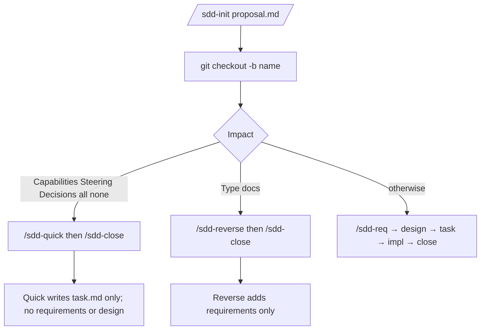
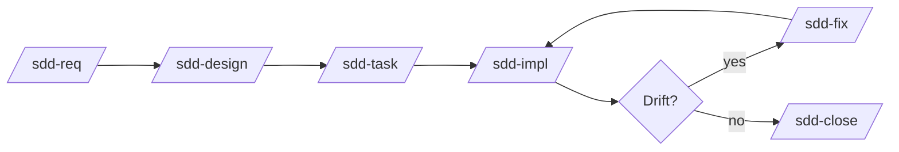

# sdd-orc

[日本語](README.ja.md)

**sdd-orc** installs agent skills and one checker script so you can run [Specification-Driven Development (SDD)](https://github.com/paterapatera/sdd-orc) in Cursor, Codex, or Claude Code. You invoke skills such as `/sdd-init` and `/sdd-req` in chat; the agent writes Markdown under your repo, and you run `check` (or let skills run it) before you merge. Package: `@paterapatera/sdd-orc` 0.3.20. Node.js 18 or later.

Registering tracker issues, opening pull requests, and writing `Closes #1` belong to a separate tracker skill. This package does not talk to a tracker.

## Folders you work with

Default docs root is `docs` (change with `init --docs-dir`).

| Path | Meaning |
|---|---|
| `docs/knowledge/` | Specs, ADRs, and steering that stay on the main branch |
| `docs/issues/<name>/` | Draft for one change while you are on Git branch `<name>`; removed when you close |

```text
docs/
  knowledge/          ← permanent specs, decision/, steering/
  issues/<name>/      ← proposal, requirements, design, task (while on branch <name>)
```

Skill text is **English**. Branch name must match the issue folder name (for example branch and folder `invoice-fix`, or `PROJ-12-invoice-fix` with a tracker prefix).

## Install

```sh
npx @paterapatera/sdd-orc init
```

| Flag | Default |
|---|---|
| `--docs-dir` | `docs` |
| `--lang` | `en` |
| `--runtime` | `node` |
| `--base-branch` | `main` |
| `--skills-dir` | `.agents` (repeat per agent) |

Example:

```sh
npx @paterapatera/sdd-orc init --lang ja --runtime bun --skills-dir .agents --skills-dir .claude
```

This writes `sdd.config.json`, copies skills to each `<skills-dir>/skills/`, and installs the checker at the first skills dir only (for example `.agents/skills/sdd-scripts/sdd.mjs`). Commit `<skills-dir>` so CI can run `check` offline.

`init` creates `docs/knowledge/` skeleton files. It does not create `steering/` (use `/sdd-steering`). If unrelated Markdown already lives under the docs dir, `init` stops; pick another `--docs-dir`. After install, different settings require `--force`.

## Update

```sh
npx @paterapatera/sdd-orc update
npx @paterapatera/sdd-orc migrate
```

`update` refreshes skills and the script; it does not edit `knowledge/`. `migrate` is for future format changes; format version 1 has nothing to convert.

## Checker commands (reference)

Default path: `node .agents/skills/sdd-scripts/sdd.mjs`

```sh
node .agents/skills/sdd-scripts/sdd.mjs check
node .agents/skills/sdd-scripts/sdd.mjs status [--issue <name>] [--all]
node .agents/skills/sdd-scripts/sdd.mjs stamp --issue <name>
node .agents/skills/sdd-scripts/sdd.mjs apply --issue <name>
node .agents/skills/sdd-scripts/sdd.mjs index
node .agents/skills/sdd-scripts/sdd.mjs renumber [--base main] [--code OLD=NEW]
```

Skills call these for you; you often run `check` and `status` yourself.

| Command | When you use it |
|---|---|
| `check` | After doc edits; skills run it at setup, before close, and during impl |
| `status` | See the next skill for this branch or issue |
| `apply` | Usually via `/sdd-close` (merges issue docs into `knowledge/`) |
| `stamp` | When a skill or error message tells you the durable file changed under a delta |
| `index` | Re-close after merge conflicts on indexes |
| `renumber` | Re-close when ids or capability codes collide with the base branch |

Useful `check` flags:

| Flag | When |
|---|---|
| `--scope setup` | First step of most skills |
| `--stage impl` | End of `/sdd-impl` (tests and open tasks) |
| `--stage close` | End of `/sdd-close` |
| `--allow-missing` | Re-close when the issue folder is already gone |
| `--format json` | Scripts or CI parsing |

Optional `testCommand` in `sdd.config.json` runs only with `check --stage impl`.

If `runtime` is `bun` and Bun is installed, you may use `bun` instead of `node`; otherwise use `node` for `sdd.mjs`.

## Skills included

`/sdd-init`, `/sdd-req`, `/sdd-design`, `/sdd-task`, `/sdd-impl`, `/sdd-fix`, `/sdd-close`, `/sdd-quick`, `/sdd-reverse`, `/sdd-steering`. There is no `/sdd-brownfield`.

## Which path to take

After `/sdd-init` writes `proposal.md`, start the branch and follow the path that matches Impact:



### Normal feature

`/sdd-req` → `/sdd-design` → `/sdd-task` → `/sdd-impl` → `/sdd-close`. If docs or code drift, use `/sdd-fix` then continue.

### Quick (small change)

`/sdd-quick` writes `task.md` only, then `/sdd-close`. Stops if specs, steering, or ADRs must change.

### Reverse (document existing behavior)

`Type: docs` in the proposal, then `/sdd-reverse` → `/sdd-close` without design or task when rules allow.

### SDD on an existing app

`init`, then `/sdd-steering`, then issues via `/sdd-init` and `/sdd-req` or `/sdd-reverse`.

### Several proposals on the base branch

Create each `proposal.md` on the base branch, use tracker keys in folder names, branch per item, close per branch.



Steps in words:

1. `/sdd-init` → `proposal.md` on the base branch (no branch yet).
2. `git checkout -b <name>`
3. Run the skills for your path; commit docs as each skill says.
4. `/sdd-close` merges the base branch, applies docs to `knowledge/`, runs checks, deletes `issues/<name>/`, prints PR title and body (does not open the PR).

## Where you decide (not the script)

| Skill | You |
|---|---|
| `/sdd-init` | Up to 3 questions (Why, What Changes, Out of Scope) |
| `/sdd-req`, `/sdd-design`, `/sdd-reverse`, `/sdd-fix` | Up to 5 scored choices per round |
| `/sdd-steering` Resync | Accept, reject, or defer each reported item |
| `/sdd-impl` | Complete manual verification tasks in `task.md` (not auto-checked) |
| `/sdd-close` | Resolve merge conflicts; confirm capability renames; copy PR text |

Quick path asks no questions. `/sdd-task` asks no questions.

## Optional walkthrough scripts

Not run by `npm test`:

- `node scripts/laravel-fixture-walkthrough.mjs`
- Clone [laravel-fp](https://github.com/paterapatera/laravel-fp), then `node scripts/laravel-fp-walkthrough.mjs` (`LARAVEL_FP` for path)

## Pull request CI (recommended)

```yaml
name: sdd
on:
  pull_request:
jobs:
  check:
    runs-on: ubuntu-latest
    steps:
      - uses: actions/checkout@v4
      - uses: actions/setup-node@v4
        with:
          node-version: 24
      - run: node .agents/skills/sdd-scripts/sdd.mjs check
```

Making this check required and keeping the branch up to date with the base branch are repository settings; this package does not enforce them.
