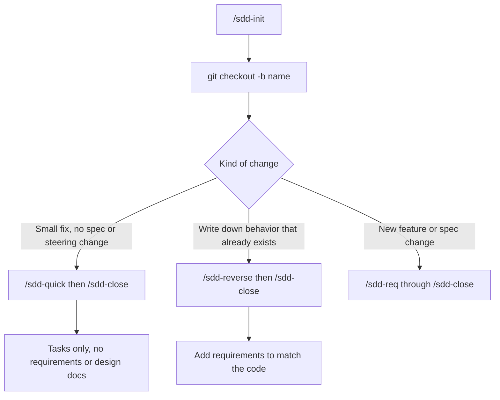
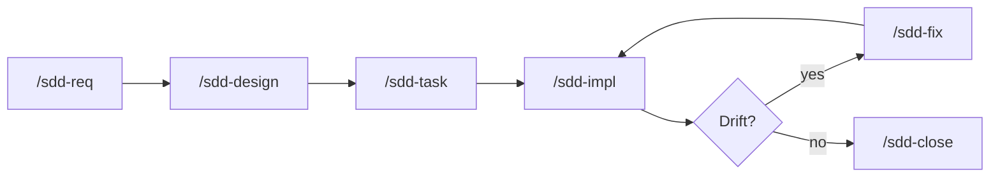
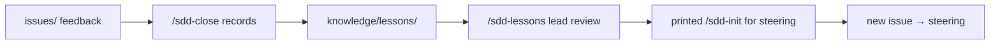

# sdd-orc

[日本語](README.ja.md)

**sdd-orc** installs agent skills and one checker script so you can run [Specification-Driven Development (SDD)](https://github.com/paterapatera/sdd-orc) in Cursor, Codex, or Claude Code. You invoke skills such as `/sdd-init` and `/sdd-req` in chat; the agent writes Markdown and runs the checker through those skills. Package: `@paterapatera/sdd-orc` 1.2.0. Node.js 18 or later.

Registering tracker issues, opening pull requests, and writing `Closes #1` belong to a separate tracker skill. This package does not talk to a tracker.

## Folders you work with

Default docs root is `docs` (override with `npx @paterapatera/sdd-orc init --docs-dir <path>`).

| Path | Meaning |
|---|---|
| `docs/knowledge/` | Specs, ADRs, and steering that stay on the main branch |
| `docs/knowledge/lessons/` | What went wrong before and which policy prevents a repeat (kept forever; status lives here) |
| `docs/issues/<name>/` | Draft for one change while you are on Git branch `<name>`; removed when you close |

```text
docs/
  knowledge/          ← permanent specs, decision/, steering/, lessons/
  issues/<name>/      ← change summary, requirements, design, task, feedback (while on branch <name>)
```

Skill text is **English**. Branch name must match the issue folder name (for example branch and folder `invoice-fix`, or `PROJ-12-invoice-fix` with a tracker prefix).

## Install

```sh
npx @paterapatera/sdd-orc init
```

**After installing:** In **agent chat**, run `/sdd-steering` first. It creates the steering documents under `docs/knowledge/steering/` (the install command does not). If the repository already has application code, the skill also reads the code and updates steering to match; on a new project it creates the initial steering set. Then start each change with `/sdd-init` on the base branch.

| Flag | Default |
|---|---|
| `--docs-dir` | `docs` |
| `--lang` | `en` |
| `--runtime` | `node` |
| `--base-branch` | `main` |
| `--skills-dir` | `.agents` (repeat per agent) |

Example:

```sh
npx @paterapatera/sdd-orc init --lang ja --runtime bun --skills-dir .agents --skills-dir .claude
```

This writes `sdd.config.json`, copies skills to each `<skills-dir>/skills/`, and installs the checker at the first skills dir only (for example `.agents/skills/sdd-scripts/sdd.mjs`). Commit `<skills-dir>` so CI can run `check` offline.

`npx @paterapatera/sdd-orc init` creates `docs/knowledge/` skeleton files. It does not create `steering/` (see **After installing** above). If unrelated Markdown already lives under the docs dir, the command stops; pick another `--docs-dir`. After install, different settings require `--force`.

## Update

```sh
npx @paterapatera/sdd-orc update
npx @paterapatera/sdd-orc migrate
```

`update` refreshes skills and the script; it does not edit `knowledge/`. `migrate` is for future format changes; format version 1 has nothing to convert.

## Script and status

Skills run the bundled checker (`check`, `stamp`, `apply`, `renumber`, `index`, `overview`, and related steps) during each phase. You do not need to run those commands yourself in normal work.

Each issue directory also has `overview.html`: a human-readable summary that **does not** change `requirements.md` or `design.md`. Run `node .agents/skills/sdd-scripts/sdd.mjs overview --issue <name>` to refresh the **generated** section (id lists, open questions, steering delta, content hash). The `/sdd-req` and `/sdd-design` skills write the **agent** section (summary bullets and decision tables) between HTML markers. `apply` never reads `overview.html`; output stays the same with or without that file.

To see the current phase and the next skill for your branch, run:

```sh
node .agents/skills/sdd-scripts/sdd.mjs status
```

Add `--issue <name>` or `--all` when you want a specific issue or every open issue.

If `/sdd-impl` should run your test suite automatically, set optional `testCommand` in `sdd.config.json`.

## Skills included

`/sdd-init`, `/sdd-req`, `/sdd-design`, `/sdd-task`, `/sdd-impl`, `/sdd-fix`, `/sdd-close`, `/sdd-lessons`, `/sdd-quick`, `/sdd-reverse`, `/sdd-steering`.

## Which path to take

After `/sdd-init` creates the change summary file, it picks the path for you and names the next skill (for example `/sdd-quick` or `/sdd-req`). Create the branch and follow that skill.



### Normal feature

New behavior or a spec change. After init points you to `/sdd-req`:



Steps (**agent chat** unless noted):

1. **Agent chat:** `/sdd-init` on the base branch (creates the change summary; no branch yet).
2. **Terminal:** `git checkout -b <name>` (same name as the issue folder init chose).
3. **Agent chat:** `/sdd-req` → `/sdd-design` → `/sdd-task` → `/sdd-impl`; commit docs as each skill says. If docs or code drift, `/sdd-fix` then continue.
4. **Agent chat:** `/sdd-close` merges the base branch, updates permanent docs, removes the issue folder, and prints PR title and body (does not open the PR).

### Quick (small change)

A small fix that does not change requirements, steering, or decision records. Same steps 1–2 as above, then **agent chat** `/sdd-quick` (task list only) → `/sdd-close`. The skill stops if a spec or steering update is needed.

### Reverse (document existing behavior)

Use reverse when the **code already behaves a certain way** but specs do not describe it yet. Typical cases: right after you adopt SDD on an existing app (backfill specs from the code), or when you find behavior you want to keep and it is not written down. You do not need to spec everything at once; start with important areas or features you will change soon.

**How this differs from `/sdd-steering`:** Steering captures **project-wide** context (purpose, tech stack, repo layout). Run it once after install. Reverse writes **one feature’s** requirements in `specs/` from code that already exists, one change at a time.

Do **not** start with `/sdd-reverse` alone. On the **base branch**, open **agent chat** and paste something like:

```text
/sdd-init Record how invoice month-end closing works today in the specs. Do not change code.
```

The important part is that you are **documenting behavior that already exists**, not shipping new features or fixing bugs. Init may ask up to three short questions; keep your answers on that same goal.

After init finishes, it writes the change summary, classifies the work as **documentation-only** (no code change in the proposal), and tells you the next skill is **`/sdd-reverse`**. Then **terminal** `git checkout -b <name>`, **agent chat** `/sdd-reverse` → `/sdd-close`. Design and task documents are often skipped; close still runs checks.

## Using with GitHub issues

Optional pattern when you track work in GitHub Issues (this package does not create issues or PRs; use a separate tracker skill or GitHub by hand).

1. **Agent chat:** On the base branch, `/sdd-init` once per planned change.
2. Create a GitHub issue for each change (tracker skill or manually).
3. Use a folder and branch name that starts with the issue number or key (example: `42-invoice-fix`).
4. **Terminal:** Commit the change summaries on the base branch.
5. **Terminal:** `git checkout -b <name>` per issue; **agent chat:** run skills through `/sdd-close`. Link the PR to the issue (`Closes #42`) when you open it yourself or via your tracker skill.

## Lessons, close, and review

While you work, skills may append short notes to `docs/issues/<name>/feedback.md` on the branch (you do not edit this for daily spec work). Keep those commits on the branch so notes are not lost before close. At **`/sdd-close`**, the agent reads those notes and **records** updates under `docs/knowledge/lessons/`: what went wrong, why, and a candidate policy. New lessons start as **`candidate`**. Recurrences add dated **Occurrence log** lines (no issue folder names). Lessons you reviewed without a new recurrence get a **Review closes** date. Before the issue folder is removed, the agent asks a **short factual** question (“record these lesson entries?”) and writes `- Lessons:` lines in `feedback.md` for check. Close does **not** adopt policies into steering, change lesson status, or print `/sdd-init`.

A **lead** runs **`/sdd-lessons`** on a schedule (for example `/sdd-lessons review this month's lessons`) to adopt (`trial`), reject, hold, or promote lessons (`effective` / `ineffective`) and to print **`/sdd-init ...`** when steering or config must change in a **new issue**. Review lists each lesson in at most one of four groups: **A** never-judged candidates, **B** held or rejected candidates with a new recurrence, **C** trials with enough **Review closes** strictly after the latest log and at least one close strictly after **Last reviewed** (same calendar day does not count), **D** trials or effectives that recurred (**D** wins over **C** when both apply; see the skill for exact rules). Lessons are never deleted; status lives in `lessons/`. Work skills read **steering** only, not lesson pages. Plain `check` may regenerate `lessons/index.md` when lesson pages change and prints a short note so you can commit the diff.

If you **re-close** after merging the base branch and the same lesson file conflicted, keep the stricter status: rejected beats ineffective, then effective, trial, and candidate; keep the Reason from the winning rejected or ineffective side.



## Where you decide (not the script)

| Skill | You |
|---|---|
| `/sdd-init` | Up to 3 questions about purpose, what changes, and what is out of scope |
| `/sdd-req`, `/sdd-design`, `/sdd-reverse`, `/sdd-fix` | Up to 5 scored choices per round |
| `/sdd-steering` Resync | Accept, reject, or defer each reported item |
| `/sdd-impl` | Complete manual verification tasks in the task list (not auto-checked) |
| `/sdd-close` | Resolve merge conflicts; confirm renamed spec codes if prompted; **confirm lesson records**; copy PR text |
| `/sdd-lessons` | **Lead:** adopt, reject, hold, or promote lessons; copy `/sdd-init` follow-ups (does not edit steering) |

Quick path asks no questions. `/sdd-task` asks no questions.

## Issue overview (`overview.html`)

Path: `docs/issues/<name>/overview.html` (same `<name>` as the branch).

**Markers (do not rename):**

| Marker | Role |
|---|---|
| `<!-- sdd-orc:overview:generated:begin -->` … `<!-- sdd-orc:overview:generated:end -->` | Written by `sdd overview <issue>`; do not edit by hand |
| `<!-- sdd-orc:overview:agent:begin -->` … `<!-- sdd-orc:overview:agent:end -->` | Written by `/sdd-req` and `/sdd-design`; preserved when you rerun `overview` |

The generated `<section data-sdd-part="generated">` includes `data-sdd-content-hash` (hash of `requirements.md` + `design.md`), lists of ADDED/MODIFIED/REMOVED ids, open and answered questions, steering changes from the design delta, and anchor spans `id="sdd-id-<ID>"`. The agent `<section data-sdd-part="agent">` sets `data-sdd-undecided-count` to the number of table cells with `data-sdd-cell="undecided"`. Summary bullets are `<li data-sdd-ids="REQ-…,IF-…">` (comma-separated, no ranges). Tables use `<div data-sdd-table="1" data-sdd-table-kind="…">` with at most **two** tables. Cell kinds: `decided` (short text + ids), `undecided`, `impossible` (needs `data-sdd-reason`), `none` (needs `data-sdd-reason`). Pick table patterns from the `/sdd-req` skill (screens, permissions, API, batch, state, migration, external, concurrency); field-value edge cases stay in the review checklist, not tables.

**Migration (1.2.0):** Every issue, including ones started on 1.1.0, must have a valid `overview.html` before `check` passes. Run `sdd overview <issue>`, then fill the agent section using `example-overview.html` next to the `/sdd-req` skill as a shape reference.

### Overview check codes

| Code | One-line fix |
|---|---|
| `OVERVIEW_MISSING` | Run `sdd overview <issue>` and write the agent section between the agent markers |
| `OVERVIEW_GENERATED_MISMATCH` | Run `sdd overview <issue>` to refresh the generated section |
| `OVERVIEW_STALE_HASH` | `requirements.md` or `design.md` changed; run `sdd overview <issue>` |
| `OVERVIEW_AGENT_MISSING` | Keep the agent section between `<!-- sdd-orc:overview:agent:begin/end -->` |
| `OVERVIEW_SUMMARY_BULLETS` | Use 3–5 `<li>` elements in `ul[data-sdd-bullets]` |
| `OVERVIEW_TABLE_COUNT` | At most two `div[data-sdd-table]` blocks |
| `OVERVIEW_UNKNOWN_ID` | Use ids from specs or this issue’s requirements delta only |
| `OVERVIEW_SUMMARY_NO_ID` | Put at least one id in summary `data-sdd-ids` or bullet text (when the delta has requirement ids) |
| `OVERVIEW_TABLE_NO_ID` | At least one `data-sdd-cell="decided"` cell must include ids (when the delta has requirement ids) |
| `OVERVIEW_UNDECIDED_COUNT` | Set `data-sdd-undecided-count` on the agent section to match undecided cells |
| `OVERVIEW_ID_RANGE` | List each id separately; do not use `〜`, `-`, `・`, or `/` between ids |
| `OVERVIEW_CELL_REASON` | Add `data-sdd-reason` on `impossible` and `none` cells |
| `OVERVIEW_BARE_ID_CELL` | Add words beside ids in decided cells (not ids alone) |
| `OVERVIEW_CELL_NO_ID` | Decided cells need at least one id in text or `data-sdd-ids` |
| `OVERVIEW_CELL_MIXED` | Split decided and undecided content into separate cells |

## Pull request CI (recommended)

```yaml
name: sdd
on:
  pull_request:
jobs:
  check:
    runs-on: ubuntu-latest
    steps:
      - uses: actions/checkout@v4
      - uses: actions/setup-node@v4
        with:
          node-version: 24
      - run: node .agents/skills/sdd-scripts/sdd.mjs check
```

Making this check required and keeping the branch up to date with the base branch are repository settings; this package does not enforce them.
