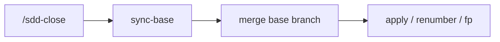
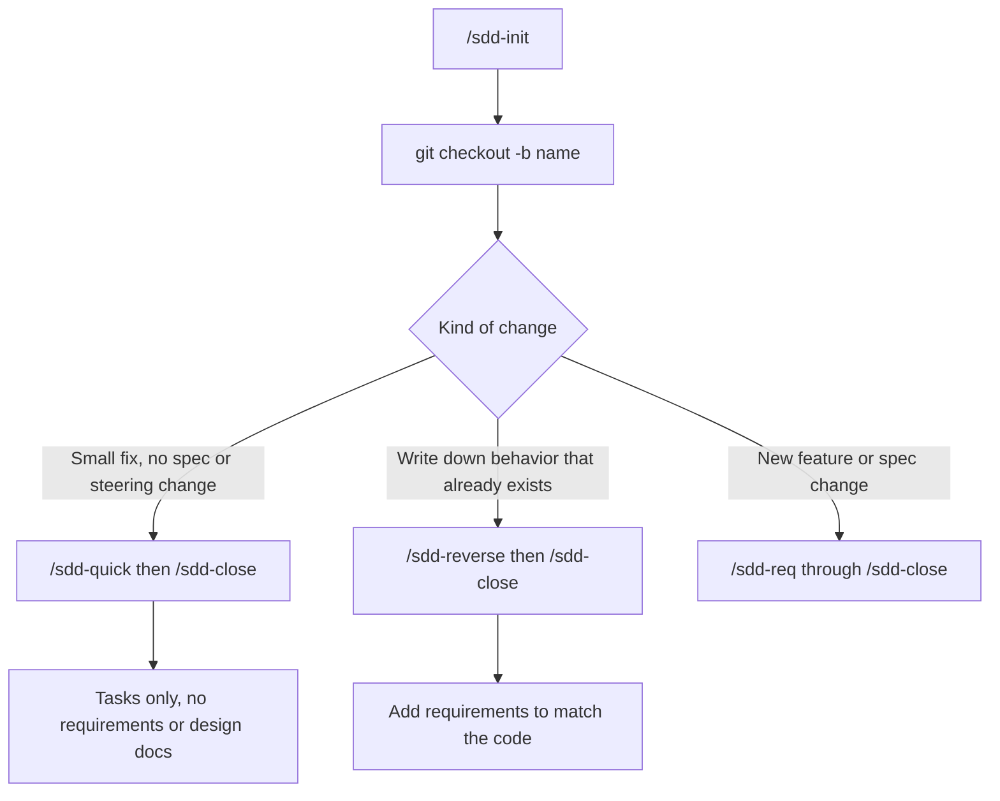
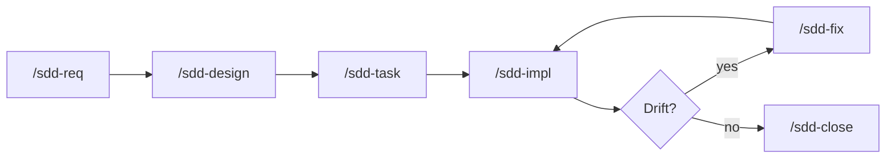
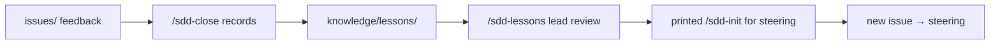

# sdd-orc

[日本語](README.ja.md)

**sdd-orc** installs agent skills and one checker script so you can run [Specification-Driven Development (SDD)](https://github.com/paterapatera/sdd-orc) in Cursor, Codex, or Claude Code. You invoke skills such as `/sdd-init` and `/sdd-req` in chat; the agent writes Markdown and runs the checker through those skills. Package: `@paterapatera/sdd-orc` 1.2.1. Node.js 18 or later.

Registering tracker issues, opening pull requests, and writing `Closes #1` belong to a separate tracker skill. This package does not talk to a tracker.

## Folders you work with

Default docs root is `docs` (override with `npx @paterapatera/sdd-orc init --docs-dir <path>`).

| Path | Meaning |
|---|---|
| `docs/knowledge/` | Specs, ADRs, and steering that stay on the main branch |
| `docs/knowledge/lessons/` | What went wrong before and which policy prevents a repeat (kept forever; status lives here) |
| `docs/issues/<name>/` | Draft for one change while you are on Git branch `<name>`; removed when you close |

```text
docs/
  knowledge/          ← permanent specs, decision/, steering/, lessons/
  issues/<name>/      ← change summary, requirements, design, task, feedback (while on branch <name>)
```

Skill text is **English**. Branch name must match the issue folder name (for example branch and folder `invoice-fix`, or `PROJ-12-invoice-fix` with a tracker prefix).

## Install

```sh
npx @paterapatera/sdd-orc init
```

**After installing:** In **agent chat**, run `/sdd-steering` first. It creates the steering documents under `docs/knowledge/steering/` (the install command does not). If the repository already has application code, the skill also reads the code and updates steering to match; on a new project it creates the initial steering set. Then start each change with `/sdd-init` on the base branch.

| Flag | Default |
|---|---|
| `--docs-dir` | `docs` |
| `--lang` | `en` |
| `--runtime` | `node` |
| `--base-branch` | `main` |
| `--skills-dir` | `.agents` (repeat per agent) |

Example:

```sh
npx @paterapatera/sdd-orc init --lang ja --runtime bun --skills-dir .agents --skills-dir .claude
```

This writes `sdd.config.json`, copies skills to each `<skills-dir>/skills/`, and installs the checker at the first skills dir only (for example `.agents/skills/sdd-scripts/sdd.mjs`). Commit `<skills-dir>` so CI can run `check` offline.

`npx @paterapatera/sdd-orc init` creates `docs/knowledge/` skeleton files. It does not create `steering/` (see **After installing** above). If unrelated Markdown already lives under the docs dir, the command stops; pick another `--docs-dir`. After install, different settings require `--force`.

## Update

```sh
npx @paterapatera/sdd-orc update
npx @paterapatera/sdd-orc migrate
```

`update` refreshes skills and the script; it does not edit `knowledge/`. **Upgrading to 1.2.0:** add `- Process:` lines to every **ADDED** and **MODIFIED** `REQ-*` in open issue deltas before `check` passes again. `migrate` is for future format changes; format version 1 has nothing to convert.

## Script and status

Skills run the bundled checker (`check`, `stamp`, `apply`, `renumber`, `index`, `status`, `fp`, `sync-base`, and related steps) during each phase. You do not need to run those commands yourself in normal work.

To see the current phase and the next skill for your branch, run:

```sh
node .agents/skills/sdd-scripts/sdd.mjs status
```

Add `--issue <name>` or `--all` when you want a specific issue or every open issue.

If `/sdd-impl` should run your test suite automatically, set optional `testCommand` in `sdd.config.json`.

## Sync base branch (`sync-base`)

Close merges your configured base branch (default `main`) and runs `renumber`, `apply`, and `fp` against the **local** ref of that branch. If teammates merged pull requests, only `origin/main` moves until you fetch — a stale local `main` makes renumber pick colliding ids, merges miss commits, and `fp` base lookups (`git show main:…`) can be wrong.

**`/sdd-close`** runs `sync-base` first. The command:

1. Picks the remote from the base branch upstream, else `origin` if it exists; with no remote it prints a one-line note and exits successfully (local-only repos).
2. Runs `git fetch <remote> <baseBranch>`.
3. Creates local `<baseBranch>` from `<remote>/<baseBranch>` when missing, or fast-forwards it when behind — **without** checking out the base branch or touching your working tree.
4. Stops with a non-zero exit if fetch fails, or if local base has commits not on the remote (ahead or diverged). It never resets your local commits.

```sh
node .agents/skills/sdd-scripts/sdd.mjs sync-base
node .agents/skills/sdd-scripts/sdd.mjs sync-base --base main
```



## Function points (`fp`)

The checker can **count custom function points (FP)** for one issue so you can compare issues or relate them to effort later. **sdd-orc does not measure time** — only a stable count from the spec delta.

Run on a feature branch (branch name = issue folder) or pass `--issue`:

```sh
node .agents/skills/sdd-scripts/sdd.mjs fp
node .agents/skills/sdd-scripts/sdd.mjs fp --issue invoice-fix --format json
```

| What | Points |
|---|---|
| `DATA-*` in `data.md` (internal data, low) | 7 each |
| `IF-*` with `Direction: Consumed` (external reference, low) | 5 each |
| `IF-*` with `Direction: Provided` | 4 each |
| Elementary **process** (`Process:` on each `REQ-*` in the issue delta) | **EI** 4, **EO** 5, **EQ** 4 per distinct process name (custom — not IFPUG/NESMA-certified) |
| `Process: none` on a REQ | 0 (REQ still listed in output) |
| `NFR-*`, steering, ADRs, structure-only delta | 0 |

Every **ADDED** or **MODIFIED** `REQ-*` in the issue delta must include `- Process: <name> (EI|EO|EQ)` or `- Process: none`. Several requirements may share one name; **`fp` counts that process once**. Example: three REQs all tagged `- Process: Confirm order (EQ)` count as **one EQ = 4 FP**, not 12.

Counts come from **ADDED**, **MODIFIED**, and **REMOVED** items in the merged issue delta (`requirements.md`, plus `design.md` and `research.md` when present). Paths under `/steering/` are skipped; other delta file sections in those documents are included. Each **requirement id** is deduped **at most once per capability file** (REMOVED > MODIFIED > ADDED); **processes** are grouped by trimmed `Process:` name and type. **Process bucket** (for the EI/EO/EQ table): **REMOVED** when every REQ in the group is REMOVED; **MODIFIED** when any REQ in that process's group is MODIFIED or REMOVED (but not all REMOVED), or the process name appears on a REQ in **base-branch** specs (`git show` only); otherwise **ADDED**. **MODIFIED** and **REMOVED** processes use the same full EI/EO/EQ weight as **ADDED**. **Quick issues** (no `requirements.md`) are skipped. Results are printed to **stdout** only. For **REMOVED** `REQ-*` without `Process` in the delta, `fp` reads the id from **base-branch** `spec.md` (same order as REMOVED `IF-*`); missing process names appear as **unknown process (0 FP)**. For **REMOVED** `IF-*`, when the delta omits `Direction`, `fp` reads **`interfaces.md` on the base branch**. **MODIFIED** `IF-*` must include `Direction` in the delta or they count as **IF unset** (0 FP).

**Known limits (REMOVED `IF-*` and process lookup):** when lookup fails, output includes **`IF unset (0 FP)`** or **unknown process (0 FP)** (not a silent zero). (1) **Stale or missing local base** — `/sdd-close` runs `sync-base` first so a normal close refreshes local `main` (or your configured `baseBranch`) from the remote before merge, renumber, and `fp`. If you run **`fp` by hand** on a clone with no local base branch (for example `git clone -b <feature>`), REMOVED IF can still score 0 and REMOVED REQ without `Process:` still appears on the **unknown process (0 FP)** line; add `- Process:` in the REMOVED block if you need the name in the report. When the base branch is missing locally, a process whose REQs in this issue are all **ADDED** is labelled **ADDED** rather than **MODIFIED** in the table; the FP total is unchanged. (2) **Same branch, earlier issue added the IF** — a later issue removes it; after apply it is not on the base branch, so REMOVED IF scores 0. (3) **Monorepo subdirectory** — git paths are from the repository root (same as `renumber`); after apply, REMOVED IF may score 0 when the checker runs outside that layout. (4) **Before apply** — `Direction` is taken from working-tree knowledge first; uncommitted edits can change the score until you commit (close normally runs after a passing check, so printed PR totals stay stable).

**`/sdd-close`** runs `fp --format json` before it deletes the issue folder and adds a short **Function points** section to the pull request text it prints (total; **DATA**, **EI**, **EO**, **EQ**, and **IF** rows with ADDED/MODIFIED/REMOVED process or item counts; REQ and distinct process counts; optional **Process: none**, **unknown process**, **IF unset**, and **NFR** lines at 0 FP; quick issues get a one-line “not counted” note only).

## Skills included

`/sdd-init`, `/sdd-req`, `/sdd-design`, `/sdd-task`, `/sdd-impl`, `/sdd-fix`, `/sdd-close`, `/sdd-lessons`, `/sdd-quick`, `/sdd-reverse`, `/sdd-steering`.

## Which path to take

After `/sdd-init` creates the change summary file, it picks the path for you and names the next skill (for example `/sdd-quick` or `/sdd-req`). Create the branch and follow that skill.



### Normal feature

New behavior or a spec change. After init points you to `/sdd-req`:



Steps (**agent chat** unless noted):

1. **Agent chat:** `/sdd-init` on the base branch (creates the change summary; no branch yet).
2. **Terminal:** `git checkout -b <name>` (same name as the issue folder init chose).
3. **Agent chat:** `/sdd-req` → `/sdd-design` → `/sdd-task` → `/sdd-impl`; commit docs as each skill says. If docs or code drift, `/sdd-fix` then continue.
4. **Agent chat:** `/sdd-close` runs `sync-base`, merges the base branch, updates permanent docs, removes the issue folder, and prints PR title and body (does not open the PR).

### Quick (small change)

A small fix that does not change requirements, steering, or decision records. Same steps 1–2 as above, then **agent chat** `/sdd-quick` (task list only) → `/sdd-close`. The skill stops if a spec or steering update is needed.

### Reverse (document existing behavior)

Use reverse when the **code already behaves a certain way** but specs do not describe it yet. Typical cases: right after you adopt SDD on an existing app (backfill specs from the code), or when you find behavior you want to keep and it is not written down. You do not need to spec everything at once; start with important areas or features you will change soon.

**How this differs from `/sdd-steering`:** Steering captures **project-wide** context (purpose, tech stack, repo layout). Run it once after install. Reverse writes **one feature’s** requirements in `specs/` from code that already exists, one change at a time.

Do **not** start with `/sdd-reverse` alone. On the **base branch**, open **agent chat** and paste something like:

```text
/sdd-init Record how invoice month-end closing works today in the specs. Do not change code.
```

The important part is that you are **documenting behavior that already exists**, not shipping new features or fixing bugs. Init may ask up to three short questions; keep your answers on that same goal.

After init finishes, it writes the change summary, classifies the work as **documentation-only** (no code change in the proposal), and tells you the next skill is **`/sdd-reverse`**. Then **terminal** `git checkout -b <name>`, **agent chat** `/sdd-reverse` → `/sdd-close`. Design and task documents are often skipped; close still runs checks.

## Using with GitHub issues

Optional pattern when you track work in GitHub Issues (this package does not create issues or PRs; use a separate tracker skill or GitHub by hand).

1. **Agent chat:** On the base branch, `/sdd-init` once per planned change.
2. Create a GitHub issue for each change (tracker skill or manually).
3. Use a folder and branch name that starts with the issue number or key (example: `42-invoice-fix`).
4. **Terminal:** Commit the change summaries on the base branch.
5. **Terminal:** `git checkout -b <name>` per issue; **agent chat:** run skills through `/sdd-close`. Link the PR to the issue (`Closes #42`) when you open it yourself or via your tracker skill.

## Lessons, close, and review

While you work, skills may append short notes to `docs/issues/<name>/feedback.md` on the branch (you do not edit this for daily spec work). Keep those commits on the branch so notes are not lost before close. At **`/sdd-close`**, the agent reads those notes and **records** updates under `docs/knowledge/lessons/`: what went wrong, why, and a candidate policy. New lessons start as **`candidate`**. Recurrences add dated **Occurrence log** lines (no issue folder names). Lessons you reviewed without a new recurrence get a **Review closes** date. Before the issue folder is removed, the agent asks a **short factual** question (“record these lesson entries?”) and writes `- Lessons:` lines in `feedback.md` for check. Close does **not** adopt policies into steering, change lesson status, or print `/sdd-init`.

A **lead** runs **`/sdd-lessons`** on a schedule (for example `/sdd-lessons review this month's lessons`) to adopt (`trial`), reject, hold, or promote lessons (`effective` / `ineffective`) and to print **`/sdd-init ...`** when steering or config must change in a **new issue**. Review lists each lesson in at most one of four groups: **A** never-judged candidates, **B** held or rejected candidates with a new recurrence, **C** trials with enough **Review closes** strictly after the latest log and at least one close strictly after **Last reviewed** (same calendar day does not count), **D** trials or effectives that recurred (**D** wins over **C** when both apply; see the skill for exact rules). Lessons are never deleted; status lives in `lessons/`. Work skills read **steering** only, not lesson pages. Plain `check` may regenerate `lessons/index.md` when lesson pages change and prints a short note so you can commit the diff.

If you **re-close** after merging the base branch and the same lesson file conflicted, keep the stricter status: rejected beats ineffective, then effective, trial, and candidate; keep the Reason from the winning rejected or ineffective side.



## Where you decide (not the script)

| Skill | You |
|---|---|
| `/sdd-init` | Up to 3 questions about purpose, what changes, and what is out of scope |
| `/sdd-req`, `/sdd-design`, `/sdd-reverse`, `/sdd-fix` | Up to 5 scored choices per round |
| `/sdd-steering` Resync | Accept, reject, or defer each reported item |
| `/sdd-impl` | Complete manual verification tasks in the task list (not auto-checked) |
| `/sdd-close` | Resolve merge conflicts; confirm renamed spec codes if prompted; **confirm lesson records**; copy PR text |
| `/sdd-lessons` | **Lead:** adopt, reject, hold, or promote lessons; copy `/sdd-init` follow-ups (does not edit steering) |

Quick path asks no questions. `/sdd-task` asks no questions.

## Pull request CI (recommended)

```yaml
name: sdd
on:
  pull_request:
jobs:
  check:
    runs-on: ubuntu-latest
    steps:
      - uses: actions/checkout@v4
      - uses: actions/setup-node@v4
        with:
          node-version: 24
      - run: node .agents/skills/sdd-scripts/sdd.mjs check
```

Making this check required and keeping the branch up to date with the base branch are repository settings; this package does not enforce them.
